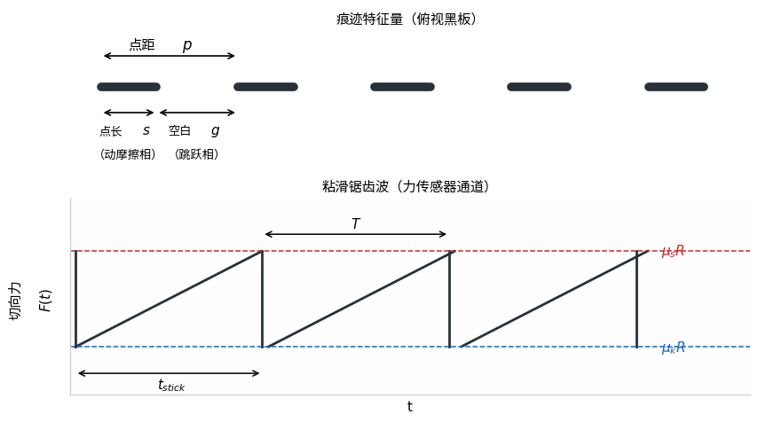
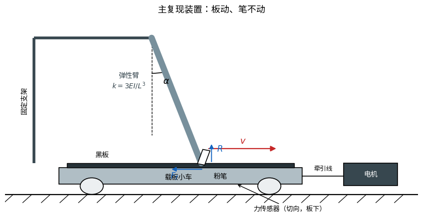

# 虚线戏法（Chalk Trick）实验与理论建模方案

——低成本、可复现的全链路研究设计：参数辨识、普遍性验证与痕迹反演

编制日期：2026 年 10 月 8 日（2026 年 10 月 24 日增补 E6A，并修正手模型假设）

> **本次模型修正：**手 / 夹持端不再简化为单一固定自由轴。现阶段并列保留“两个正交弹簧”和“一个自由轴加一个轴向弹簧”两种候选，未完成实验判别前不作选择。
>
> **统一模型边界（2026-10-25）：**现有主模型及 S1–S3 只是固定铰轴、轴向自由度冻结、尖端罚弹簧接触的 N 下降段退化子模型，至分离即停止；不包含上升段、自由飞行、再接触/碰撞和多周期，也不等同于候选 A/B 的完整手模型。其结果均为数值预言，不是实验事实。当前仓库未见可用于最终标定的 E1/E4 实测数据；参数来源、占位状态、仿真—实验速度窗口、观测量分级及刚度符号统一见 `docs/研究记录/参数与证据总表.md`。
>
> **符号约定：**接触刚度记为 k_n（旧 S1–S3 的 k_c），结构刚度记为 k、k_x、k_y 或 k_a，率态临界刚度记为 k_crit。本文 Markdown 为当前有效版本；DOCX/PDF 排版版若细则不一致，以本文及上述总表为准。

本文档面向“虚线戏法”课题研究（官方题目：在某些条件下，当一支粉笔在黑板上拖动时，即使运动是连续的，留下的痕迹也不是一条连续线，而是周期性的点序列；其他书写材料和表面也可能发生这种情况；研究支配这一现象的物理参数）。方案依据三份参考材料（IPT 预选拔范本报告、Rabinowicz 1956 年粘滑综述、Ballard 2016 年分岔理论论文）整理，总目标是在基础普通物理实验室条件下，以可控成本完成三件事：辨识并测量支配该现象的全部物理参数、在其他书写材料与表面上验证参数框架的普遍性、并以痕迹盲反演检验对参数的掌握程度。

方案组织：第一章给出物理图像与差异化切入点；第二章列出参数全图与核心关系式；第三章为实验矩阵 E1–E8（含增补实验 E6A）；第四章为三层理论模型 T1–T3；第五章汇总反演链路；第六至八章分别为成本、时间线与风险；第九章为参考文献。

## 目录

- 一、题目背景与物理图像
- 二、物理参数全图
- 三、实验方案（E1–E8，含增补实验 E6A）
- 四、理论建模（T1–T3）
- 五、痕迹反演逻辑
- 六、成本清单
- 七、时间线与里程碑
- 八、风险与应对
- 九、参考文献

## 一、题目背景与物理图像

### 1.1 题目陈述与任务拆解

> *“在某些条件下，当一支粉笔在黑板上拖动时，即使运动是连续的，留下的痕迹也不是一条连续线，而是周期性的点序列。其他书写材料和表面也可能发生这种情况。研究支配这一现象的物理参数。”（“虚线戏法”官方题目）*

要点解析：①现象发生在“某些条件下”——存在条件（接触角、速度、载荷、刚度等参数窗口）本身就是研究对象；②痕迹是“周期性的点序列”——周期性是可量化、可检验的特征；③现象不限于粉笔—黑板——参数框架必须能推广到其他书写材料与表面；④核心任务是“研究支配现象的物理参数”——辨识、测量并定量组织这些参数。范本报告采用的英文表述（从痕迹反演运动参数与粉笔尺寸）与官方题目互为表里：反演是参数研究最有说服力的验证方式。

据此将课题拆解为四个递进的任务：

-   任务 A（复现与条件）：搭建受控机械装置复现现象，测定虚线出现的参数窗口（回答“某些条件”），摆脱手绘的不确定性；

-   任务 B（参数辨识）：测量全部支配参数——界面摩擦、弹性臂刚度、运动学、几何与材料参数，并把它们组织为少数无量纲判据；

-   任务 C（普遍性）：在其他书写材料与表面上验证同一套参数框架（回答“也可能发生”）；

-   任务 D（验证）：建立“痕迹 → 参数”的定量链路，通过盲测反演检验参数掌握度。

### 1.2 现象的物理图像：粘滑三相循环

该现象属于粘滑（stick-slip）自激振动：两个固体表面相对滑动时，若系统中存在弹性储能环节且静、动摩擦存在差异，连续驱动会被转化为周期性的“粘着—滑脱”运动。同类现象包括提琴弓弦发声、雨刮器跳动、地震断层的间歇滑动等。对手持粉笔而言，手与夹持端并非刚性连接，也不宜先验简化为单一固定自由轴；其弹性和自由度需要通过实验辨识。当前并行保留“两个正交弹簧”和“一个自由轴加一个轴向弹簧”两种候选模型。粉笔受动摩擦拖行时，夹持与弹性结构逐渐储能，当系统达到起滑或脱接触条件时，粉笔滑脱、回弹并可能离开板面，随后重新接触，循环往复，在板面上留下点状痕迹。

一个完整的粘滑周期可分为三相：

-   动摩擦相（画点）：粉笔尖贴板滑动，留下点状痕迹，弹性臂持续加载；

-   静止点（粘着）：粉笔尖相对板面静止，静摩擦锁定，弹性臂随牵引继续弯曲储能；

-   跳跃相（空白）：弹性力突破最大静摩擦，粉笔回弹并脱离板面，板面留下空白，随后重新接触进入下一周期。

**图 1 痕迹特征量（点距 p、点长 s、空白 g）与粘滑锯齿波**

由此得到本课题的核心可观测量：点距 p = v·T（牵引速度乘以周期），以及点长、空白、线宽等痕迹特征量。它们与物理参数的定量关系构成第二章与第五章的内容。

### 1.3 已有基线与六个差异化缺口

IPT 公布的预选拔范本报告已给出一条完整基线：以橡胶弹性梁模拟人手，建立三相理论（悬臂梁自由振动描述跳跃相，由本征方程给出振动周期）；实测粉笔—黑板静摩擦系数 0.62 ± 0.03、动摩擦系数 0.51 ± 0.02；发现虚线仅出现在接触角约 10°–25° 的窗口内；且痕迹线宽与粉笔直径近似相等（y = x 标定）。该基线存在六个可直接攻击的缺口，即本方案的差异化切入点：

-   缺口 1：静摩擦系数随接触时间增长（Rabinowicz 的结点位蠕变）被忽略——不同点频对应不同粘着时间，这可能是其点距数据系统性偏离理论的来源；

-   缺口 2：动摩擦系数的速度依赖被忽略，而范本自己承认“这对低速下的理论预测影响很大”；

-   缺口 3：声学测量仅被写入“建议”——粉笔撞击板面的咔哒声包含精确接触时刻，是零成本、44.1 kHz 采样率的数据通道；

-   缺口 4：范本只做了正向预测，没有完成题目真正要求的盲反演（仅凭痕迹反推参数）；

-   缺口 5：尺寸反演仅做到“直径 = 线宽”，且观测到的非周期异常（疑似混沌）未作深究；

-   缺口 6：未考察其他书写材料与表面——现象的普遍性没有实验支撑，而官方题目明确要求。

## 二、物理参数全图

### 2.1 参数清单

下表汇总支撑该现象的全部物理参数、物理角色与获取实验（E 编号见第三章）。

| **类别** | **参数（符号）**                                           | **物理角色**                     | **获取实验** |
|----------|------------------------------------------------------------|----------------------------------|--------------|
| 界面摩擦 | 静摩擦系数 μₛ（含时间依赖 μₛ(t)）                          | 决定起滑阈值与跳跃时机           | E1           |
| 界面摩擦 | 动摩擦系数 μₖ(v)（含速度依赖）                             | 决定画点相的减速与能量耗散       | E2           |
| 弹性臂   | 等效刚度 k = 3EI/L³                                        | 储能器；决定临界挠度与周期       | E3           |
| 弹性臂   | 阻尼比 ζ、一阶固有频率 ω₁                                  | 跳跃相的自由振动与衰减           | E3、E5       |
| 手 / 夹持 | 候选 A：正交刚度 k_x、k_y；候选 B：轴向刚度 k_a 及转动参数 | 描述两向平动或轴向伸缩—转动耦合；两种候选暂不选定 | E3、E5 |
| 粉笔     | 直径 d、长度 ℓ、质量 m                                     | 题目第二问的反演对象             | E6、E7       |
| 粉笔     | 尖端几何与磨损率                                           | 决定线宽及其沿笔画的演化         | E6           |
| 运动学   | 牵引速度 v                                                 | 直接控制点距                     | E4、E5       |
| 运动学   | 接触角 α、法向载荷 R                                       | 控制连续线—虚线转变              | E4           |
| 系统     | 板取向（水平 / 竖直）                                      | 重力在跳跃相中的角色             | E4           |
| 材料体系 | 书写材料 × 表面（粉笔 / 铅笔 / 马克笔 × 黑板 / 玻璃 / 纸） | 普遍性验证的对象                 | E8           |
| 可观测量 | 点距 p、点长 s、空白 g、线宽 w、点距涨落 σ_p/p             | 反演与周期性度量的输入           | E6           |
| 可观测量 | 笔痕相对强度 I、法向接触力 N                               | 接触过程标定、脱接触判别与力反演 | E5、E6、E6A  |

### 2.2 核心关系式

以下关系式构成“参数 ↔ 痕迹”的定量骨架（推导见第四章）。式中 F_p 为弹性臂回复力，R 为板面对粉笔的支持力，α 为弹性臂与板面法线的夹角，ξ 为臂端挠度。

$$
F_{s}\cos\alpha=F_{p}+R\sin\alpha
\tag{1}
$$

粘着相沿板方向的力平衡（粉笔相对板面静止时）。

$$
\mu_{s}R\cos\alpha=F_{p}+R\sin\alpha
\tag{2}
$$

临界起滑条件：弹性力增长到静摩擦极限时，粘滑循环的跳跃被触发。

$$
k=\frac{3EI}{L^{3}}
\tag{3}
$$

悬臂弹性臂的等效刚度（E 为杨氏模量，I 为截面二次矩，L 为臂长）；改变 L 即可扫描 k。

式（3）仅用于实验弹性臂本身的刚度标定，不等价于完整手模型，也不意味着系统只有单一刚度或单一固定转轴。

$$
\xi_{\max}=\frac{R\left(\mu_{s}\cos\alpha-\sin\alpha\right)}{k}
\tag{4}
$$

由式 (2)、(3) 得到的临界挠度：起滑瞬间弹性臂的弯曲量。

$$
t_{\mathrm{stick}}=\frac{\xi_{\max}-\xi_{\mathrm{stop}}}{v}
\tag{5}
$$

粘着相时长：牵引速度越慢，粘着越久，点距越大。

$$
p=vT=v\left(t_{\mathrm{stick}}+t_{\mathrm{flight}}+t_{\mathrm{slip}}\right)
\tag{6}
$$

点距主关系：点距 = 牵引速度 × 周期，周期由三相时长组成。

$$
p\approx\frac{\left(\mu_{s}-\mu_{k}\right)R}{k}
\tag{7}
$$

准静态近似（滑移与跳跃时间远小于粘着时间时）：点距直接给出摩擦差——反演的核心公式。该式仅适用于单方向、准静态、小变形极限；在两种候选手模型未完成判别前，不作为通用点距公式。

$$
v=\frac{p}{T}
\tag{8}
$$

声学通道给出周期 T 后的“零相机”测速公式。

## 三、实验方案（E1–E8，含增补实验 E6A）

### 3.1 总览与主装置

全部实验按“先标定、后复现、再反演”的顺序组织。主复现装置采用“板动、笔不动”布局（图 2）：黑板固定于滑轨小车，由减速电机经绕线轮与鱼线恒速牵引（速度 1–20 cm/s，光电门校验）；粉笔粘接于硅胶弹性臂下端，弹性臂固定于龙门支架，接触角 α 由铰链与量角器设定；法向载荷 R 通过预压挠度设定，并用电子秤替换板面进行标定。该布局便于在板下布置力传感器，记录切向力锯齿波与法向接触力曲线。另设竖直板变体（还原真实黑板取向），用于检验重力在跳跃相的角色。

**图 2 主复现装置示意（板动、笔不动）**

| **编号** | **名称**           | **核心方法**                     | **主要产出**               |
|----------|--------------------|----------------------------------|----------------------------|
| E1       | 静摩擦及其时间依赖 | 可调斜面 + 静置时间扫描          | μₛ 分布、μₛ(t) 律          |
| E2       | 动摩擦速度依赖     | 电机牵引 + 力传感器扫速          | μₖ(v) 曲线                 |
| E3       | 弹性臂与手 / 夹持标定 | 静态挂码 + 动态拨振 + 两向 / 轴向加载 | k、ω₁、ζ、两向与轴向刚度、候选模型判别数据 |
| E4       | 主复现装置         | 板动笔不动恒速牵引               | 可重复虚线、相图数据       |
| E5       | 三通道同步测量     | 切向 / 法向力 + 声学 + 高速视频  | t_stick、t_flight、T、N(t) |
| E6       | 痕迹计量学         | 标定网格 + 图像分割              | p、s、g、w 统计            |
| E6A      | 强度—法向力标定    | 同步测力 + 原始灰度 + 升降力检验 | I–N 标定带、有效反演域     |
| E7       | 盲反演锦标赛       | A/B 组对抗 + 公开视频            | 反演精度                   |

### 3.2 E1 静摩擦系数及其时间依赖

目的：获取静摩擦系数的分布及其随粘着时间的演化，直接补缺口 1。

-   方法：以黑板为可调斜面，缓慢增角至粉笔初始滑动，由临界角正切得静摩擦系数；每条件重复 ≥30 次取分布而非单次值；

-   时间扫描：倾斜前控制静置时间 0.5–120 s，拟合 μₛ(t) = μ₀ + A·ln(t/t₀)，预期 A > 0（对应结点位蠕变）；

-   控制：每次使用新鲜粉笔段与固定跑道；同一块板不同区域先做摩擦测绘；记录温湿度。

成本：约 0 元（普物室斜面与量角器）。

### 3.3 E2 动摩擦系数及其速度依赖

目的：获取 μₖ(v)，补缺口 2，并为 T3 的稳定性判据提供 (b−a) 估计。

-   方法：电机牵引 + 力传感器水平拉粉笔，速度 5–200 mm/s 扫描；另用斜面 + Tracker 视频分析加速度交叉验证；

-   拟合 μₖ(v) = μₖ₀ + a·ln(v/v₀)，判定速率弱化（a < 0，利于自激粘滑）或速率强化；

-   注意：低速段（< 20 mm/s）加密采样——范本的理论偏差主要出现在此区间。

### 3.4 E3 弹性臂与手 / 夹持端标定

目的：给出弹性臂 k、ω₁、ζ，并测量手 / 夹持端的两向平动、轴向伸缩与转动响应，为两种候选手模型提供参数和判别数据；不再以单一固定自由轴或单一等效刚度作为先验假设。

-   静态法：臂端挂砝码测挠度—力曲线，斜率即 k（可用两倍长梁提高挠度分辨率，再按 L³ 换算回实际臂长）；

-   动态法：拨动臂端，用 240 fps 慢动作测一阶频率 ω₁ 与振幅包络，对数减幅法得 ζ；两法互验；

-   手 / 夹持端准静态标定：沿两个正交方向分别施加力，记录力—平动位移及转角；沿轴向拉压，记录轴向力—位移曲线。候选 A 以 k_x、k_y 描述两向平动刚度，候选 B 以轴向刚度和转动参数描述轴向伸缩—转动耦合；

-   模型判别：两种候选使用同一组标定数据拟合，并在未参与标定的载荷方向、幅值和频率下比较预测。当前不预选最终模型；若两者误差接近或参数不可辨识，应明确保留“暂不可判别”，而不是仅凭拟合优度选定其一；

-   手绘对照：记录手绘虚线和持笔手的两向 / 轴向响应，供 E7 对比；范本给出的约 1.74 N/cm 仅作单方向量级参考，不再视为完整手刚度。

### 3.5 E4 主复现装置

目的：可重复地产生虚线，并扫出 (α, v, R) 参数空间。

-   牵引：12 V 直流减速电机 + 大直径绕线轮（抑制速度波动），速度经光电门在线校验；步进电机 + 丝杠为备选方案；

-   角度：铰链 + 量角器，α 覆盖 5°–35°，重点加密 10°–25° 虚线窗口；

-   载荷：预压挠度设定 R，电子秤替代板面标定；竖直板变体检验重力取向；

-   判定：每条件画 ≥3 条笔画，记录连续 / 虚线 / 不规则状态，供相图使用。

### 3.6 E5 三通道同步测量

目的：对单个粘滑周期实现时间分辨，检验三相模型与范本的“3τ/4 跳跃时长”假设，并获得 N 下降段及脱离临界点的直接力测量。

-   力通道：板下力传感器记录切向锯齿波，读出力降 ΔF 与周期 T；增加法向力测量，记录 N(t) 卸载曲线。法向力通道的量程、分辨率、带宽、采样率与安装刚度应满足快速脱接触测量，并检查零点、振动背景和惯性影响；

-   声学通道：手机麦克风贴近接触区，44.1 kHz 采样，咔哒声时间戳给出接触 / 脱离时刻（t_stick、t_flight）；

-   视频通道：240 fps 侧拍笔尖及夹持端标记点，Tracker 追踪笔尖轨迹、夹持端平动、转角与轴向位移，分离三相，并为两种候选手模型提供运动学判别数据；

-   同步：电机启动同时触发 LED 闪光，三通道对齐；注意 240 fps 对 50–100 Hz 振动欠采样，周期测量以声学通道为准。

-   测量链分级与验收：按“周期/接触事件—N(t) 卸载波形—本构微小时差”三层核定目标时间尺度、传感器带宽、采样率、同步误差和滤波。S1 最短卸载约 0.0499 ms，按每事件约 10 点估算需约 200 kS/s；S3 换向滞后 0.009–0.115 ms 对应约 1.11 MS/s 至 87 kS/s 的起步量级，且最短滞后需微秒级同步。普通手机与 LED 对齐不足以检验最短滞后，设备不达标时明确记为“当前不可检验”。声学时间戳需估计或标定声传播延迟，不称为未经校准的精确时刻。详见 `docs/研究记录/参数与证据总表.md` 第 6 节。

### 3.7 E6 痕迹计量学

目的：把痕迹变成统计数据与可标定的强度观测量。

-   采集：板面旁置标定网格，手机微距垂直拍照（或用平板扫描仪）；固定照明、曝光与拍摄距离，并保留原始灰度图像；

-   处理：几何特征采用阈值分割 + 连通域分析，自动提取点距 p、点长 s、空白 g、线宽 w；每条件 ≥30 个点取分布而非均值；相对强度另在未二值化图像上提取，避免把灰度阈值造成的截断误判为物理突变；

-   相对强度：统一感兴趣区域、背景与照明校正，检查灰度响应的线性区和饱和区，不用二值化结果代替强度测量；

-   磨损曲线：提取线宽沿笔画的演化 w(x)，供 T3 磨损反演使用；

-   周期性度量：除均值外给出点距涨落 σ_p/p 与点列功率谱，把“周期性”量化为可对比指标。

### 3.7A E6A 法向接触力—笔痕相对强度联合标定与反演

目的：在 E1–E3 参数标定和 E4–E6 测量链路基础上，检验笔痕相对强度与法向接触力是否存在单调、可重复的关系，并在有效标定域内由笔痕反演 N，辅助检验 N 下降段及脱接触模型。

-   同步测量：固定板速、接触角、粉笔批次与预磨规程、板面跑道、照明和曝光；高精度力传感器记录 N(t)，同步保留原始灰度图像与高速视频。传感器带宽、采样率和安装刚度应能分辨快速脱接触，并检查零点、振动背景与惯性影响；

-   分级标定：在多级稳定法向力下绘制等长笔迹，取稳定段强度，每级重复测量；建立 I–N 标定曲线及置信带，并在预期脱离临界区加密测点；

-   单值性检验：分别进行升力、降力和不同板速实验，检查滞回、速度依赖、磨损漂移与灰度饱和；若关系随条件改变，应使用分条件标定面，不能强行用单一曲线反演；

-   反演边界：只在单调且灵敏度足够的区间反演；零强度仅表示脱接触或低于检测限，不直接等价于 N = 0。由标定斜率、灰度噪声和重复性传播反演不确定度；

-   独立验证：标定组与验证组分开。E1–E3 参数冻结后，用新工况的笔痕反演 N，并与 E5 传感器直接测得的法向力曲线比较，不用验证组重新调参；

-   动态验证与正向观测模型：多级稳定法向力首先得到的是准静态、笔画平均的 I–N 关系，不能自动用于毫秒级瞬时 N(t) 反演。须另用可重复的非恒定 N(t) 波形做标定外验证，并建立由模型 N(t)、相对滑移和接触区间到预测灰度的正向映射；未完成前优先比较归一化形状和宏观特征，并明确反演对象究竟是瞬时 N、单点平均 N、整条笔画平均 N，还是仅能判别接触/脱接触；

-   截断判别：若原始强度已趋近背景且截断位置随图像阈值移动，则优先判为表观截断；若截断前存在有限临界强度且对应可重复的临界 N，则支持真实脱接触突变，需在模型中引入脱接触判据或失稳机制。

产出：I–N 标定曲线或曲面、有效反演区间、滞回与速度 / 磨损依赖、反演误差，以及截断前的临界强度和临界法向力。

### 3.8 E7 盲反演锦标赛（核心亮点）

目的：直接回答题目——仅凭痕迹能反推什么、精度多高。

-   对抗设计：A 组秘密设定 (v, α, R, d) 画线，B 组仅凭痕迹照片与标定关系反推，按各参数相对误差评分；

-   标定库：先用 E4–E6 建立 p(v, α, R) 与 w(d, x) 标定曲面，并由 E6A 建立笔痕相对强度—法向接触力标定关系；

-   法向力反演：仅在 E6A 确认的有效标定域内，由笔痕相对强度反演 N，并与 E5 的直接力测量对照；零强度和灰度饱和区不作连续反演；

-   拓展：对公开流传的 Lewin 手绘视频做同款反演——由帧率估计 v，并在指定候选模型及其适用极限下反推相应等效参数，与 E3 测量对照；不在模型未选定前报告唯一的“手刚度”。

### 3.9 E8 材料普遍性矩阵

目的：验证参数框架对其他书写材料与表面的普遍性（官方题目明确要求“其他书写材料和表面也可能发生这种情况”）。

-   材料矩阵：书写材料取普通石膏粉笔、无尘碳酸钙粉笔、铅笔（石墨）、蜡笔、白板马克笔；表面取黑板、玻璃、白板、铜版纸；组合约 8–10 组；

-   方法：沿用 E4 装置与同一弹性臂，按 E1–E2 规程测每组合的 μₛ 与 μₖ(v)，扫 (α, v) 判定是否出现周期性点序列及其窗口；

-   负结果同样记录：马克笔等油墨体系的接触机制不同（黏附—毛细作用），若不出点，记录并讨论机制差异；

-   产出：各组合在无量纲判据平面上的落点与虚线窗口，检验 T3(e) 的“边界重合”预言。

成本：约 50 元（文具采购）。

## 四、理论建模（T1–T3）

### 4.1 T1 低维集总模型（两种候选手模型并行）

手 / 夹持端不再预设为单一固定自由轴。现阶段并行保留以下两种候选，暂不决定最终采用哪一种：

-   **候选 A——两个正交弹簧：**以两个正交方向的平动为自由度，分别具有刚度 k_x、k_y；必要时再引入阻尼和耦合项。

-   **候选 B——一个自由轴加一个轴向弹簧：**同时保留绕轴转动与轴向伸缩自由度，以轴向刚度和转动参数描述储能与几何耦合。

两者的参数均由 E3 标定，并由 E5 的同步运动学与力曲线进行独立判别。以下单向弹簧—质量模型只保留为候选 A 在单方向、小变形、忽略法向耦合时的退化极限，不再视为完整手模型或唯一主力模型。黑板以速度 v 拖动时，其运动方程为：

$$
m\ddot{x}=k(vt-x)-F_{f}\!\left(\dot{x}_{\mathrm{rel}}\right)
\tag{9}
$$

-   粘着判据：\|k(vt − x)\| ≤ μₛR；滑移时摩擦力取 μₖ(v)·R；

-   准静态解析（质量可忽略）：粘着相弹性力线性增长，起滑时力降 ΔF = (μₛ − μₖ)R，t_stick = ΔF/(kv)，点距即式 (7) 的 p ≈ (μₛ − μₖ)R/k；

-   含质量时滑移相为衰减振荡，点长 s 由振荡过冲决定；

-   数值方案：保留现有单向 Python 分段积分与事件检测作为基线，同时分别为候选 A、候选 B 建立状态变量、接触约束与事件检测；代入 E1–E3 实测摩擦参数和相应手模型参数，在未完成模型判别前并列输出预测，不将某一候选的结果作为唯一理论曲线；

-   灵敏度分析：除点距对摩擦与运动学参数的偏导外，分别评估两向刚度、轴向刚度与转动参数的影响，指导 E3 精度分配和模型可辨识性分析。

### 4.2 T2 连续弹性梁模型（追平并检验范本）

跳跃相中粉笔脱离板面，弹性臂做自由振动，由 Euler–Bernoulli 梁方程描述。

需要强调，T2 描述的是实验弹性臂或等效连续体的动力学，不等同于已经完成手模型选择。它与候选 A / B 的连接方式及适用条件，须在 E3、E5 判别后确定；在此之前不因 T2 的存在而排除任一候选。

$$
EI\frac{\partial^{4}\xi}{\partial z^{4}}+\rho_{l}\frac{\partial^{2}\xi}{\partial t^{2}}=0
\tag{10}
$$

固支—自由边界条件下的本征方程为：

$$
\cosh(\beta L)\cos(\beta L)=-1\quad\Longrightarrow\quad\beta_{1}L\approx1.875
\tag{11}
$$

-   跳跃相时长：范本直接取一阶周期的 3τ/4——用 E5 的声学 / 视频数据检验该假设，成立与否都是新结果；

-   动摩擦相：在梁方程中加入动摩擦分布载荷 q，求平衡位形与停止时刻 t_K，点长 s = ξ(L, t_K) − v·t_K；

-   临界角预测：由式 (2) 给出连续线—虚线转变的 α 窗口，与 E4 相图对照。

### 4.3 T3 进阶理论方向

#### （a）率态摩擦与临界刚度

采用 rate-and-state 摩擦律 μ(v, θ) = μ₀ + a·ln(v/v₀) + b·ln(v₀θ/D_c)，状态变量 θ 按 θ̇ = 1 − vθ/D_c 演化。对稳态滑动做线性稳定性分析，可得临界刚度：

$$
k_{\mathrm{crit}}=\frac{(b-a)N}{D_{c}}
\tag{12}
$$

由 E2 的 μₖ(v) 斜率估计 (b−a)，预言 k_crit；再改变臂长 L 扫描 k = 3EI/L³，寻找虚线区消失的实验边界——理论预言与实验验证在同一参数上闭环，这是教科书级的理论—实验互证。注意 E2 的稳态速度曲线只能约束速率依赖组合，不能单独辨识 D_c；后者需要速度阶跃、滑移—停止—再滑移等动态滑移数据，未补齐前不给出唯一 k_crit 数值。

式（12）建立在单方向集总模型上，仅用于相应的单方向极限。若最终采用两个正交弹簧或自由轴加轴向弹簧，必须基于对应的多自由度模型重新进行稳定性与临界条件分析，不能直接沿用单一 k_crit 判据。k_crit 是稳定性阈值，与 S1–S3 的接触刚度 k_n（旧 k_c）不是同一物理量。

#### （b）Ballard 分岔视角

倾斜粉笔使法向载荷 R 与切向挠度发生几何耦合：即使摩擦系数与速度无关，稳态滑动解也可能在摩擦系数越过临界值时失去唯一性（分岔），从而产生粘滑。判别实验：若 E2 表明 μₖ(v) 为速率强化（a > 0）而粘滑依然发生，则支持结构机制而非本构机制——这是可以直接写进报告的机制判定实验。

#### （c）相图与倍周期

在 (α, v) 平面（再扩展 k 轴）打点绘制连续线 / 虚线 / 不规则三区边界；对声学时序做 FFT 寻找倍周期级联，呼应范本引用的混沌开关模型（Wiercigroch 1994），把范本留下的“异常点”升级为可控、可测量的研究现象。

#### （d）磨损与尺寸反演

以 Archard 磨损律 V = K·N·s/H 描述笔尖平台随行程的增长：线宽沿笔画渐变 w(x) = 2r(x)，由渐变率反推磨损系数与初始直径，把范本的“线宽 = 直径”（y = x 标定）升级为含磨损修正的尺寸反演。

#### （e）无量纲化：把“支配参数”压缩为判据

官方题目要求“研究支配现象的物理参数”，最有力的回答形式是把众多参数组织为少数无量纲组合。对参数集 {μₛ, μₖ, k, R, v, d, ω₁, g} 做量纲分析（Buckingham Π），可得若干无量纲组，例如：摩擦落差 Δμ = μₛ − μₖ；无量纲点距 Π₁ = pk/R ≈ Δμ（即以 R/k 为自然尺度的点距）；惯性与弹性时间比 Π₂ = v/(d·ω₁)。由此给出可检验预言：在 (Δμ, Π₂) 等无量纲平面上，不同材料—表面组合的虚线区边界应当重合。E8 的材料矩阵正是对这一预言的检验；若成立，即证明这些无量纲组才是支配现象的本质参数，而单个参数只是其表象。

当前无量纲组中的单一 k 只对应单方向极限；候选 A 应考虑 k_x、k_y 的组合，候选 B 则应纳入轴向刚度及转动惯量等参数。手模型未选定前，不把现有无量纲平面视为最终普适相图。

## 五、痕迹反演逻辑

官方题目要求“研究支配现象的物理参数”，盲反演则是检验参数掌握度最直接的方式：若参数体系自洽且完备，仅凭痕迹即可反推实验条件与粉笔尺寸。反演链路总表如下。总体策略是“知三推一”：固定三个参数，反演第四个；多通道交叉给出置信度。

| **可观测量**            | **反演公式 / 途径**                     | **目标参数**       | **依赖实验** |
|-------------------------|-----------------------------------------|--------------------|--------------|
| 点距 p、周期 T（声学）  | v = p/T                                 | 牵引速度 v         | E5、E6       |
| 点距 p、R、k            | p ≈ (μₛ − μₖ)R/k                        | 摩擦差 Δμ          | E1–E3        |
| 线宽 w                  | y = x 标定 + 磨损修正                   | 粉笔直径 d         | E6           |
| 线宽渐变 w(x)           | Archard 磨损律                          | 磨损系数、初始直径 | E6、T3       |
| 点距—角度关系 p(α)      | 临界挠度公式 (4)                        | k 或 R（知三推一） | E4–E6        |
| 锯齿波力降 ΔF           | ΔF = (μₛ − μₖ)R                         | μₛ − μₖ            | E5           |
| t_stick / t_flight 比值 | 三相模型                                | 梁刚度与频率校验   | E5、T2       |
| 笔痕相对强度 I          | E6A 标定曲线 / 曲面的反函数（限有效域） | 法向接触力 N       | E5、E6、E6A  |

不确定度预算要点：p 的统计误差由 ≥30 点分布给出；R 与 k 的标定误差经灵敏度分析传播到反演结果；报告中以误差椭圆或相关系数矩阵呈现反演置信度。笔痕反演 N 的不确定度还需包括标定斜率、灰度噪声、板速与磨损漂移；零强度和灰度饱和区不作连续反演。

模型适用边界：表中所有含单一 k 的反演式仅在单方向、准静态、小变形极限下使用。两种候选手模型未完成判别前，不把这些关系作为通用反演公式；若不同候选给出不同反演结果，应并列报告模型依赖与不确定度。

## 六、成本清单

假设普通物理实验室已提供力传感器、光电门、天平与手机（慢动作）。E5 / E6A 所用法向力传感器需另核对量程、分辨率、带宽与安装刚度。以下为新增采购，总预算控制在 350 元以内。

| **物品**               | **规格 / 用途**                                         | **估价** | **对应实验** |
|------------------------|---------------------------------------------------------|----------|--------------|
| 直流减速电机 + 驱动    | 恒速牵引（备选：拆 3D 打印机步进电机 + 丝杠）           | ¥60–120  | E2、E4       |
| 抽屉滑轨 ×2            | 载板小车导向                                            | ¥30      | E4           |
| 硅胶棒 / 橡胶棒        | 弹性臂（多备几种模量以扫 k）                            | ¥30      | E3、E4       |
| 教学黑板 / 黑板贴      | 复现与斜面两用                                          | ¥50      | E1、E4       |
| 鱼线、绕线轮、五金杂件 | 牵引与装夹                                              | ¥30      | E4           |
| 手机支架 + 微距镜头    | 视频与痕迹拍摄                                          | ¥40      | E5、E6、E6A  |
| 粉笔（多规格直径）     | 参数扫描与磨损研究                                      | ¥20      | 全部         |
| 书写材料与表面套装     | 石膏 / 碳酸钙粉笔、铅笔、蜡笔、马克笔、玻璃板、白板纸等 | ¥50      | E8           |
| 合计                   | ——                                                      | ≤ ¥350   | ——           |

软件全部免费：Tracker（视频追踪）、ImageJ / OpenCV（图像分析）、Python（数值模拟与数据处理）。

## 七、时间线与里程碑

| **周次**  | **任务**                                                    | **里程碑产出**                                        |
|-----------|-------------------------------------------------------------|-------------------------------------------------------|
| 第 1–2 周 | E1–E3 摩擦、弹性臂与手 / 夹持标定 | μₛ(t)、μₖ(v)、k、ζ；两向 / 轴向刚度与候选模型判别数据 |
| 第 3–4 周 | 搭建 E4 主装置，力（切向 / 法向）、声学、视频联调，复现虚线 | 首条可重复虚线 + 同步数据与 N(t) 曲线                 |
| 第 5 周   | (α, v, R) 参数扫描 + E6 痕迹计量 + E6A 联合标定             | 标定曲面 p(v, α, R)、相图初版、I–N 标定带与有效反演域 |
| 第 6 周   | E8 材料矩阵 + E7 盲反演与 Lewin 视频                        | 普遍性结论 + 反演精度报告                             |
| 第 7 周   | T1–T3 理论闭环、撰写报告                                    | 完整研究报告                                          |

## 八、风险与应对

| **风险**               | **影响**                                   | **对策**                                                                        |
|------------------------|--------------------------------------------|---------------------------------------------------------------------------------|
| 粉笔磨损漂移           | 数据随笔画长度系统性漂移                   | 固定笔画长度、定时换笔；把磨损升级为研究对象（T3d）                             |
| 板面不均匀             | 摩擦的空间涨落污染统计                     | 固定跑道；预先做摩擦测绘；制定清洁规程                                          |
| 牵引速度波动           | 点距周期性抖动                             | 大直径绕线轮 + 飞轮；光电门在线校验                                             |
| 视频欠采样             | 50–100 Hz 振动混叠                         | 以 44.1 kHz 声学通道为周期基准                                                  |
| 湿度变化               | 粉笔 / 板面摩擦漂移                        | 记录温湿度；必要时粉笔烘干、板面除潮                                            |
| 非周期异常（混沌迹象） | 周期统计失效                               | 单列为研究现象（T3c），不混入周期统计                                           |
| 手模型自由度误设 | 单一固定自由轴或单一刚度导致虚假的 N 下降、脱接触或点距预言 | 两种候选并行；用 E3 两向 / 轴向加载与 E5 同步运动学进行独立判别，证据不足时报告“暂不可判别”，不给出唯一模型结论 |
| 材料体系差异过大       | 跨材料比较失真                             | 统一弹性臂、载荷与速度规程；以无量纲组而非原始参数对比                          |
| 力通道动态响应不足     | 快速脱接触被抹平或测量系统改变原接触动力学 | 核对量程、分辨率、带宽、采样率与安装刚度；做零点、惯性及振动背景检查            |
| 灰度饱和或阈值截断     | 把表观截断误判为物理突变，或造成强度多值   | 固定照明与曝光，保留原始灰度；标定光学线性区，几何分割与强度提取分开            |
| 强度—力关系非单值      | 笔痕反演法向力失真                         | 检验升力 / 降力滞回及速度、磨损依赖；只在单调、可重复且灵敏度足够的标定域内反演 |

## 九、参考文献

[1] IPT. The Chalk Trick Pre-selection Report（范本报告，ipt.science 模型报告库，编号 2903）.

[2] E. Rabinowicz. Stick and Slip. Scientific American, 194(5): 109–118, 1956.

[3] P. Ballard. Can the stick-slip phenomenon be explained by a bifurcation in the steady sliding frictional contact problem? Discrete and Continuous Dynamical Systems Series S, 9(2): 363–381, 2016.

[4] C. Wensrich. Stick-slip motion in harmonic oscillator chains subject to Coulomb friction. Tribology International, 39: 490, 2006.

[5] M. Wiercigroch. A note on the switch function for the stick-slip phenomenon. Journal of Sound and Vibration, 175: 700–704, 1994.

[6] L. D. Landau, E. M. Lifshitz. Theory of Elasticity (Course of Theoretical Physics, Vol. 7). Butterworth-Heinemann, 1986.

[7] J. H. Dieterich. Modeling of rock friction: 1. Experimental results and constitutive equations. Journal of Geophysical Research, 84(B5): 2161–2168, 1979.

[8] A. L. Ruina. Slip instability and state variable friction laws. Journal of Geophysical Research, 88(B12): 10359–10370, 1983.
