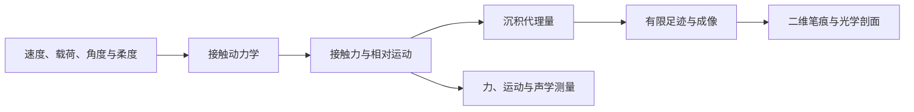

# 粉笔虚线现象研究进展汇报

汇报日期：2026年11月2日  
研究对象：粉笔在黑板上连续推进时形成断续笔痕的动力学机制及可观测特征。  
资料范围：本地研究记录、各仿真结果说明与结果表、首批实验测量及图像/声学分析，并核对GitHub `develop`的更新日志与S4v1补充扫描。  
汇报性质：已有工作与结果的阶段汇编；本次未新增实验、未重跑仿真。文中后续任务均为计划。

## 一、总体进展

目前，课题已从文献调研和单段动力学探索，推进到**多自由度接触模型、数值可靠性检查、首批测量分析，以及有限足迹观测模型**的阶段。模型已经能够在指定参数下给出不同痕端形态，实验资料也开始约束模型应当解释什么、哪些现象仍无法判定。

本阶段有四项主要进展：

1. **完成v1到v2的建模扩展。**从固定铰轴、仅描述法向力下降段的模型，扩展到包含手端两向柔度、等效转动/弯曲刚度和单边接触的三自由度瞬态模型。在占位参数下，v2可产生法向力近似平台及有限沉积强度截断。
2. **定位并修正影响结论的计算问题。**统一空间沉积后处理，修正手端预载符号；利用容差、步长、接触阻尼和初始化对照，区分积分误差、接触模型差异与伪事件。
3. **取得并分析首批实验资料。**已有静摩擦阈值夹逼记录、粉笔几何尺寸，以及两组手绘虚线与配对录音的探索性分析；获得了摩擦系数的条件性估计和声学重复时间尺度。
4. **将二维足迹和成像过程纳入比较。**图像分析发现亮区几何、跨高度峰位错位及近上限亮部会影响一维剖面，S8因此增加了从沉积到二维图像的正向映射。

**当前判断：模型探索和观测方法已形成基础，但实际装置的参数标定、完整周期和独立定量验证尚未闭合。**已有结果支持继续推进受控测量与模型对照，尚不足以认定唯一的虚线形成机制。

## 二、研究目标与整体思路

课题围绕三个相互关联的问题开展：

- 粉笔持续推进时，为什么会出现滑移、停顿或接触状态改变，并留下周期性空白？
- 板速、法向载荷、接触角、摩擦性质和夹持柔度如何影响点距、点长、周期和痕端形态？
- 在明确测量条件和适用范围后，笔痕与声音能恢复哪些运动或力学信息？

目前形成的研究链条如下。图中各环节是建模与测量的接口，不代表全部环节均已完成实验验证。

这条链条使力学预测与图像观测之间的中间过程变得明确。研究中需要分别验证动力学、沉积假设和成像映射，才能由最终痕迹讨论接触过程。

## 三、研究推进过程

| 阶段或日期 | 主要工作 | 形成的成果与认识 |
|---|---|---|
| 前期文献与方案阶段 | 梳理黏滑、摩擦诱导振动、离面跳跃及相关接触机制，设计E1–E8实验体系 | 建立研究问题、实验分工与模型候选，形成综述、方案和操作指导 |
| 截至10月23日 | 建立N下降段模型，完成S1接触刚度、S2正则化、S3摩擦本构对比 | 得到单次滑移后半段的分离、换向和沉积特征，同时发现参数敏感性 |
| 10月24—25日 | 研究评审、模型边界审查、空间强度勘误、v2规格与S4–S7、S5b、S6b | 修正后处理和预载问题；建立多自由度瞬态与刚性接触参考；更新实验接口 |
| 10月27日 | 完成S4v1的245点补充扫描 | 确认旧模型扫描范围内未出现预期失稳，关闭继续扩大该支线的常规任务 |
| 10月28—29日记录 | 分析挂重驱动方案，记录E1与粉笔尺寸，处理配对录音及二维笔痕 | 取得首批实验约束；发现足迹和成像对痕端判断的影响 |
| 10月30日（trunk分支） | 完成Chalk Trick预选报告、Elmer 1997、Tonazzi 2020及Champneys–Várkonyi 2016四篇文献译稿 | 形成摩擦动力学、双稳态与接触机制的精读材料；见[trunk日志](https://github.com/sifangmian-lab/ipyt-chalktrick/blob/trunk/docs/研究记录/更新日志.md) |
| 本次核查时已有 | S8有限足迹正向观测模型与示例比较 | 给出几何展宽的计算示例，并暴露仅凭一维曲线选型的歧义 |
| 11月2日 | 重写研究计划并同步；整理进展展示材料 | 后续主线调整为测量补齐、实测标定、完整周期和独立验证 |

更新日志中保留了修正前后的历史条目。本汇报引用v2数值时，以**预载修正后的结果表**为准；旧版峰值、旧版基线和已撤回解释不作为当前结论。

## 四、理论模型与仿真实验结果

### 4.1 v1：完成单段探索，明确了模型的适用边界

v1将粉笔视为绕固定轴转动的刚体棒，尖端通过法向罚弹簧与板面接触。给定交接载荷和角速度后，计算法向力下降至分离的过程，并输出分离时间、相对速度换向及沉积空间分布。

S1–S3已经回答了该模型内部的三个问题：

| 仿真 | 主要结果 | 当前用途 |
|---|---|---|
| S1：接触刚度扫描 | 在已扫工况中，输出对接触刚度持续敏感；固定交接载荷的大刚度段出现分离时间约随刚度负二分之一次方变化的标度 | 说明接触参数需要约束；该标度只能在相应模型和固定条件下使用 |
| S2：正则化扫描 | 指定参数附近存在对正则化相对稳健的区间；过大的平滑尺度会改变甚至抹去速度切换 | 用于判断数值平滑是否影响单段结论，不能直接搬用到低速实验 |
| S3：LuGre对比 | 摩擦内态可改变换向时刻和相对沉积量，并给出力—速度换向滞后的候选预言 | 用于机制与本构敏感性探索；参数未独立辨识，微小时差尚无实验验证 |

S4v1进一步扫描了摩擦系数、几何比和接触刚度，共245个点。49组几何—摩擦组合中，分离时间随接触刚度均严格单调，扫描内未见未分离、跳变或相应失稳。该积分器与S1已有结果的105个可分离点对照全部通过，分离时间最大相对偏差约为2.14×10⁻⁶。

这些结果主要明确了v1的结构限制：它不含真正的黏着相、再加载和多周期过程，不能承担完整虚线的预测。扫描中没有找到失稳，也不能用来排除真实系统中的Painlevé或reverse chatter机制。

### 4.2 v2：能够产生候选痕端形态

v2引入手端切向/法向弹簧、等效转动/弯曲刚度和单边法向接触，比较弹簧—滑块型摩擦、含黏性项LuGre与tanh摩擦。当前实现仍是三自由度集总瞬态模型，尚未完成连续梁及完整周期验证。

下面给出预载修正后的基线A。参数为数值设定：板速0.5 m/s、初始载荷4 N、切向刚度300 N/m、法向支撑刚度10⁶ N/m、转动刚度10³ N·m/rad、接触刚度2×10⁴ N/m，静/动摩擦系数取0.62/0.51。它们不是一组已完成实验标定的参数。

| 指标 | 软罚接触基线 | 刚性接触参考 |
|---|---:|---:|
| 数值定义下的首次停止时刻 | 1.816 ms | 1.550 ms |
| 法向力范围 | 3.969–4.000 N | 4.000–4.730 N |
| 法向力相对标准差 | 约0.25% | 约5.19% |
| 单事件空间跨度 | 约0.442 mm | 约0.409 mm |
| 截断前沉积强度/平台强度 | 1.002 | 1.000 |
| 空间积分/时间累计沉积代理量 | 0.99994 | 1.00001 |

这里“相对标准差”是对应统计区间内标准差与均值之比，不能与最大最小值的相对差混用；截断比是模型沉积代理量的指标，不是实验JPEG亮度比。

基线结果说明，模型中可出现**法向力仍有限而相对滑移接近停止**的候选痕端过程。但首次停止不等于形成了持续黏着或稳定周期；是否对应实际笔痕结束，还需要同步测量和观测模型共同检验。

### 4.3 本构选择会影响痕端解释

S7在同一占位基线下比较三种摩擦本构，修正后结果如下：

| 本构 | 首次停止时刻 | 截断前/平台沉积强度 | 含义 |
|---|---:|---:|---|
| LuGre-springslider | 1.816 ms | 1.002 | 形成较清晰的有限强度截断候选 |
| 含黏性项LuGre | 1.129 ms | 0.646 | 形成较明显的下降尾 |
| tanh | 1.987 ms | 0.932 | 存在速度接近零的过程，但本构本身不提供静摩擦黏着分支 |

这说明痕端形态可对本构敏感，然而目前不能以“哪条曲线更像照片”直接确定真实摩擦律。静摩擦、动摩擦和瞬态参数需要分别约束，E1的静摩擦初测也不能单独确定整套LuGre参数。

### 4.4 参数平面给出的重要否定性结果

S6/S6b完成了柔度、板速和角度—摩擦扫描，得到三项直接影响研究路线的认识：

- 在软罚接触的指定扫描中，未形成可用于实验的角度相关黏着/脱离边界。静摩擦系数不低于0.22的80个工况中，79个被分为平台加截断；唯一例外位于55°、0.22的临界减速工况。
- 高接触刚度下的部分“停止前脱离”对接触阻尼敏感；刚性接触的大角度分类又受到初始锚定在约35.3°附近的近奇异影响。这些分界暂不能解释为物理相边界。
- 低板速是当前模型的薄弱区。占位参数下，0.05 m/s时单事件空间跨度约0.006 mm，0.1 m/s时约0.018 mm；部分工况首停后很快再滑。需要核查实际参数、初始化和再加载，而非将首停标签直接视为稳定黏着。

因此，下一步的重点是实际工况标定和完整周期，而不是继续用未标定模型扩大相图。

## 五、数值可靠性检查与关键修正

### 5.1 空间沉积后处理已统一

沉积时间代理采用与摩擦功率相关的形式：

$$
q(t)=\alpha |F_t(t)v_{\mathrm{rel}}(t)|,\qquad
\int I(\xi)\,\mathrm d\xi=\int q(t)\,\mathrm dt.
$$

其中α为待标定系数，I为单位空间长度的沉积代理。统一后处理以q·dt作为空间分箱权重，并对回划经过同一位置的贡献求和。

旧实现曾使用不一致权重，影响折叠峰的大小和跨脚本比较；相关图与解释已修正。旧版约500 J/m的峰值不再使用。在单次通过、相对速度非零且采用上述沉积律时，I=α|Ft|，不能仅因速度下降就认为空间沉积按1/v发散。

### 5.2 预载修正改变了基线与柔度解释

v2手端法向弹簧的预载符号曾导致错误的初始净力。修正后，基线A的法向力相对标准差由约3.1%降至0.25%，首次停止时刻由约1.689 ms改为1.816 ms。S4–S7已按修正模型更新。

因此，旧版“法向支撑刚度单独决定平台”的解释需要调整：软接触时，接触柔度可能掩盖支撑刚度的影响；刚性接触参考中，支撑刚度的作用更明显。实验上应联合约束接触刚度、支撑柔度和阻尼。

### 5.3 已开展的校验及其边界

已有记录包括双容差/步长、接触阻尼、刚性接触约束残差、初始化敏感性、沉积守恒，以及回归用例。S5b基线刚性接触的约束加速度残差约3×10⁻¹³，同一接触参数下的积分结果具有良好一致性。

这些检查支持对指定模型计算结果的复现，但不能代替物理验证。罚接触与刚性参考在部分基线指标上约7%–15%的差异，是两种建模口径的差别，不是所有真实工况误差的上界。历史日志中“回归通过”对应当时版本；本次汇报只核对既有记录和数值，未重新运行整套测试。

## 六、实验测量与数据分析进展

### 6.1 E1：取得静摩擦阈值的初步约束

现有记录给出板长60.0 cm，上界高度37.4、35.5、35.0、34.5、34.0 cm，下界高度33.6、33.8、33.9 cm。按板长为斜边、高度为两端竖直高差计算：

$$
\mu_s=\tan\theta_c=\frac{h}{\sqrt{L^2-h^2}}.
$$

若全部上下界来自同条件下对同一起滑阈值的夹逼，则最窄区间为：

| 项目 | 条件性计算结果 |
|---|---:|
| 临界高度 | 33.9–34.0 cm |
| 临界倾角 | 34.40–34.52° |
| 静摩擦系数 | 0.68477–0.68775 |
| 区间中点 | 约0.6863 |

这是所报界限形成的区间，不是统计置信区间，中点也不是独立重复试验的均值。样品编号、仪器误差、加载速率、等待时间及是否存在滚动/倾覆尚需核实，接触方式与书写尖端是否一致也未确定。因此该结果保留为初测约束，尚未覆盖模型参数，更不能由此推定动摩擦系数。

### 6.2 粉笔几何：已有实测尺寸，仍需补质量与边界

| 测量项目 | 原始记录 |
|---|---:|
| 大头直径 | 10.845 mm |
| 小头直径 | 8.185 mm |
| 整支长度 | 78.54 mm |

该尺寸与旧模型半径3.5 mm、长80 mm的设定不同，后续需要建立对应样品的参数版本。还应补测质量、夹持位置、实际自由长度、端部形状和磨损；整支长度不能直接替代等效模型杆长。现有记录未提供量具及测量不确定度，保留原始精度不代表已达到相同测量准确度。

### 6.3 配对录音：获得约10–20 ms的声学重复尺度

已确认29号录音对应图1，30号录音对应图2，两条笔画均从左向右。代表区间结果为：

| 组别 | 选取录音时段 | 包络脉冲间隔中位数 | 间隔10%–90%分位数 | 中位间隔的倒数 |
|---|---|---:|---:|---:|
| 29号/图1 | 0.60–1.08 s | 19.75 ms | 19.00–20.75 ms | 50.63 Hz |
| 30号/图2 | 0.73–0.92 s | 9.75 ms | 8.60–10.90 ms | 102.56 Hz |

带通范围与峰显著度对照后，代表窗口的中位间隔较稳定，支持两组局部声学重复节奏约相差两倍。上述窗口经人工选取，分位数描述单次书写内的变化，不能代表整笔稳定频率或统计置信区间。

当前没有同步的速度、载荷、角度及逐事件运动学记录。因此，频率差不能单独归因于速度，重复声峰也未被确认等于逐个碰撞或笔痕周期。10–20 ms与v2约1–2 ms的首次停止时长属于不同观测量，不能直接比较以判断模型对错。

### 6.4 二维图像：发现一维剖面解释的限制

单痕剖面分析得到以下直接观察：

- 图2不同候选痕迹存在单峰、宽顶和多峰，没有统一的收尾形状。
- 图2候选8、11、15、20的积分亮度与有效亮区宽度相关系数约0.93、0.99、0.97、0.91。两者取自同一图像且定义存在耦合，不能据此估计压力变化有多少来自几何。
- 图2候选8、11的亮区像素中，灰度不低于250的比例约36%、31%，说明亮部接近8位图像上限；白色平台不能直接用作恒定沉积或恒定法向力的证据。
- 图1候选30、44、51在5行窄带分析中的跨高度峰位跨度分别约15、8、13 px。该差异是空间错位，不能解释为事件时间差或滑移距离。

由此可以确认二维亮区形状会影响一维汇总剖面，但还不能把图中的每个峰对应到一次力峰、回划或碰撞。图像积分量J(x)是背景扣除后的光学量，尚未完成相机响应、尺度和足迹标定，不能直接等同于模型I(ξ)、粉尘质量或N(t)。

## 七、S8有限足迹观测模型的进展

S8已经实现“一维沉积源→非负归一化二维足迹→光学模糊→逐像素相机响应→图像与剖面”的正向处理，并检查了沉积代理总量守恒、线性叠加、点足迹极限及相机响应次序。现有情景计算的最大质量代理守恒误差约4.44×10⁻¹⁶；这一守恒发生在相机非线性响应之前，不能推广为灰度积分守恒。

以预设沉积源跨度4 px的情景为例，弹簧—滑块源经过不同足迹后，对图1候选44、51的剖面比较如下：

| 足迹情景 | 候选44的NRMSE | 候选51的NRMSE |
|---|---:|---:|
| 点足迹 | 0.211 | 0.302 |
| 有限直立足迹 | 0.186 | 0.265 |
| 有限倾斜足迹 | 0.107 | 0.178 |

加入倾斜足迹能够改善这些示例的形状拟合，支持将几何展宽纳入后续比较。但足迹几何参考了候选44，像素源跨度和模糊参数是情景设定，比较还调整了正亮度增益与横向位置；候选51共享设定也不等于独立物理验证。

另一项重要结果是，平台截断源与下降尾源经过同一足迹后可能更相似。它提示：即使图像拟合改善，也未必能够区分两种力学来源。**S8当前的价值是建立观测接口并识别歧义，尚未完成从照片反演接触力。**

## 八、阶段结论与尚未完成的验证

| 认识 | 当前证据性质 | 汇报中的结论边界 |
|---|---|---|
| v2可产生近似N平台及有限沉积强度截断 | 指定占位参数下的数值结果 | 是候选机制的可实现性，尚未证明实验痕端机理 |
| 接触与支撑柔度、本构会改变痕端及时间尺度 | 参数/本构对照和数值校验 | 实际控制参数和作用大小仍需标定 |
| 手绘虚线有局部较规则的声学重复节奏 | 两组代表窗口的探索性结果 | 尚未确认声峰—笔痕—接触事件的一一对应 |
| 二维几何与成像影响一维光学剖面 | 图像观察及S8正向示例 | 不能由多峰、平台或零尾直接认定碰撞、恒压或离面 |
| 静摩擦约0.686是有价值的初测参考 | 条件性阈值夹逼计算 | 未完成重复性和误差评估，不能视为最终材料常数 |
| 完整虚线周期与唯一机理 | 尚无闭合的独立验证 | 保留纯黏滑、离面再接触、回划及检测限等候选解释 |

目前尚缺的关键证据是：同一装置下独立测得的摩擦/柔度参数；可重复虚线的同步力与运动；已标定的足迹和成像过程；以及参数冻结后的完整周期预测。

## 九、下一阶段安排

下一阶段按已修订的[研究计划](研究计划_2026-11-02.md)推进。以下为拟执行工作，未计入已完成成果。

| 顺序与建议时间 | 核心任务 | 预期交付及验收 |
|---|---|---|
| 第1–2周，11月2—15日 | 核实E1条件、补独立重复；称量及测自由长度；完成E2速度扫描、E3柔度初标；补带尺标、多曝光图像 | 有来源与误差的首版实测参数集，明确可用图像和不可辨识项 |
| 第3–4周，11月16—29日 | 复现受控虚线，核实同步事件；推进S8独立观测标定和S9完整周期 | 至少一组可重复、逐事件可核验的数据；完整周期解或可复算的失败原因 |
| 第5–6周，11月30日—12月13日 | 冻结可辨识参数，开展S10独立留出验证，补速度—载荷边界 | 对周期、点距、点长、事件类别和二维笔痕给出误差与适用范围 |
| 验证通过后 | E7痕迹反演试点及E8小范围材料对照 | 只在已验证的尺度、相位和观测域内报告反演或推广结论 |

近期实验的建议起点是：E1基准条件至少30次独立测量；受控虚线先做3档速度×3档载荷×至少3次独立笔画；有条件时每次记录至少20个候选周期。上述数量是计划配置，应按预试验离散度调整，单条笔画内的多个笔痕不能计作独立实验重复。

首要判别任务是区分“相对滑移停止但仍接触”“脱离/再接触”“沉积低于检测限”。需要按目标事件时间尺度验收传感器带宽、采样率、曝光和同步误差；普通240 fps视频可用于粗运动跟踪，不能承担亚毫秒痕端次序判决。硬件不足时保留未判定类别，先完成可分辨的几何与周期测量。

## 十、成果与依据索引

| 类别 | 主要成果与位置 |
|---|---|
| 研究组织 | [更新日志](更新日志.md)、[参数—证据总表](参数与证据总表.md)、[当前研究计划](研究计划_2026-11-02.md) |
| 模型定义与修正 | [v2规格](模型v2规格_2026-10-25.md)、[模型更新影响评审](模型更新影响评审_2026-10-25.md)、[报告勘误](../模型报告/粉笔_N下降段_报告勘误_2026-10-25.md) |
| v1数值基准 | [S1](../../simulations/S1_kc刚性极限收敛扫描/结果说明.md)、[S2](../../simulations/S2_ε灵敏度扫描/结果说明.md)、[S3](../../simulations/S3_LuGre本构对比/结果说明.md) |
| v1补充扫描 | [S4v1远端结果说明](https://github.com/sifangmian-lab/ipyt-chalktrick/blob/develop/simulations/S4v1_%CE%BCh%E5%8F%82%E6%95%B0%E5%B9%B3%E9%9D%A2%E6%89%AB%E6%8F%8F/%E7%BB%93%E6%9E%9C%E8%AF%B4%E6%98%8E.md) |
| v2基线与数值校验 | [S4](../../simulations/S4_v2正交弹簧基线/结果说明.md)、[S5](../../simulations/S5_v2收敛性/结果说明.md)、[S5b](../../simulations/S5b_v2接触极限/结果说明.md)；数值表位于各目录 |
| v2参数与本构 | [S6](../../simulations/S6_v2参数平面/结果说明.md)、[S6b](../../simulations/S6b_v2角度摩擦平面/结果说明.md)、[S7](../../simulations/S7_v2本构对比/结果说明.md) |
| 实验测量与分析 | [E1原始记录](E1_斜面静摩擦原始数据_2026-10-29.md)、[录音/笔痕分析](../../experiments/E5E6_20261029_audio_marks/README.md)、[光学剖面](../../experiments/E5E6_20261029_intensity/README.md)、[图1窄带分析](../../experiments/E5E6_20261029_intensity/photo1_examples/README.md) |
| 粉笔尺寸 | [几何尺寸实测记录](粉笔几何尺寸实测记录.md)，2026-11-02补档 |
| S8观测模型 | [归档说明与结果](../../simulations/S8_有限足迹观测模型/结果说明.md)、[观测内核](../../code/observation_model.py)、[示例脚本](../../code/demo_observation_model.py)、[不变量检查](../../code/tools/check_observation_model.py)，2026-11-02补档，原始计算日期待核实 |
| 实验规程 | [实验方案及v2增补](../实验指导/虚线戏法ChalkTrick实验与理论建模方案.md)、[E5测量链](../实验指导/E5_痕端事件测量链_2026-10-25.md)、[E6A判据](../实验指导/E6A截断判据执行清单_2026-10-25.md) |

本汇报采用实测记录、探索性分析、数值结果和后续计划分列的口径。完整周期S9、冻结参数验证S10及后续反演，均尚未作为已完成研究结果报告。
