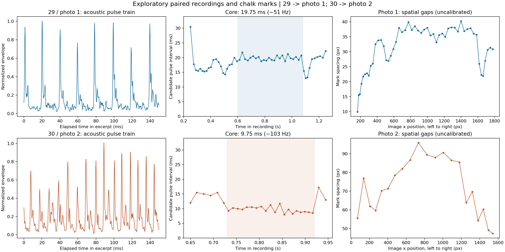

# 手绘虚线的配对录音与笔痕：探索性分析

分析日期：2026-10-29。材料来自本项目对话，不能视为受控速度、受控载荷实验。

## 数据对应与用户补充

- **标准录音 29.mp3 → 图1**（`d2a6526bb6f1086368877baa030f4871.jpg`）。
- **标准录音 30.mp3 → 图2**（`6bdf24127abb42523c34b0b10f273987.jpg`）。
- 两条均从左向右书写。用户说明是随手画的，主要改变速度，并感到速度越大时需要更大的按压力。
- 初始消息附有28号录音，随后用户明确补充29号对应图1，故正式配对分析不使用28号录音。
- 未提供尺标、速度/压力/角度时序、握持长度、同步视频或重复试次。不能确认除速度之外其他变量相同；也未由独立测量确定两组实际速度大小。

原始媒体不重复上传；`summary.json` 保留文件名、SHA-256 和处理参数。全部几何结果为照片缩放到1824像素宽后的坐标，不是毫米。

## 已提取的结果

| 对应组 | 用于周期统计的录音时段 | 声学包络脉冲间隔中位数 | 间隔10%–90%分位数 | 中位间隔的倒数 |
|---|---|---:|---:|---:|
| 29号 / 图1 | 0.60–1.08 s | 19.75 ms | 19.00–20.75 ms | 50.63 Hz |
| 30号 / 图2 | 0.73–0.92 s | 9.75 ms | 8.60–10.90 ms | 102.56 Hz |

这两个窗口是人工选取的、脉冲较清楚的代表区间，不代表整笔稳定不变。分位数描述单次书写内的间隔变化，**不是统计置信区间**。30号前段间隔约15 ms，后段约9 ms，频率随书写过程变化。

改变带通范围（600–14000、1200–12000、2000–10000 Hz）与峰显著度（0.18、0.22、0.28）后，29号核心窗口的中位间隔仍为19.75 ms；30号为9.75–9.875 ms（约101–103 Hz）。完整敏感性结果在 `summary.json`。这支持“代表区间声学重复节奏约相差两倍”的初步结果；不支持把频率差单独归因于速度。

图1沿书写方向的点距先增大，中段相对均匀，后段出现收紧；图2后段点距总体减小，最右端存在笔痕重叠。照片有反光、透视差异及边缘截断，因此：

- 只保留可分割内部区间的像素几何趋势；图2的最右重叠区不纳入点距曲线。
- 不跨照片比较像素距离、绝对亮度或由此推断压力大小。
- 自动分割的段数不是经认证的总笔痕数；声学候选峰数也不是接触/碰撞事件数。
- 没有强行配对逐个笔痕与声峰。两组文件对应，不等于内部事件已经一一对齐。



## 由此可以推进的研究

### 1. 为完整周期模型提供时间尺度

数据给出约10–20 ms的声学重复时间尺度候选。只有进一步确认一个重复声学事件与一个笔痕属于同一周期，才能将它作为笔痕周期。它与现有v2单次滑移停止时间不是同一观测量，不能直接用来判定原单事件模型正确或错误，也不能代入单段卸载标度反演接触刚度。

下一步先让模型能够输出多周期笔痕及重复频率；以运动学测量判断周期中是否存在离面、再接触及冲击。仅有重复声音和空白笔痕不能区分纯黏滑、离面跳跃、回划及沉积低于检测限。

### 2. 为由笔痕恢复运动建立测量链

如果已核实相邻声学事件对应相邻笔痕的相同相位，则

\[
T_i=t_{i+1}-t_i,\qquad \lambda_i=x_{i+1}-x_i,\qquad
\bar u_i=\lambda_i/T_i.
\]

其中 $\bar u_i$ 是相邻标记事件之间的平均空间推进速度，不是接触点瞬时滑移速度，也不自动等于手端速度。没有尺标时只能得到像素/秒或相对趋势；增加同平面尺标后才能得到米/秒。应先解决边缘缺失、一个笔痕多个声峰、次级振铃及事件相位的歧义，再逐点反演。

当前图2的点距收紧与30号录音后段重复变快，提示点距变化可能同时包含推进速度与重复频率的作用。未经逐事件对齐，尚不能量化各自贡献。

### 3. 把操作感受变为速度—载荷边界假说

“高速时需要更大按压力”目前是用户操作感受，应记录为待检验假说：维持可持续虚线的条件可能是速度与法向载荷的共同作用。它不是已测出的 $N\propto v$ 关系，也不能据此判断动摩擦系数随速度增长。

建议分两步补实验：

1. 保持同一粉笔、握持长度及接触角度，加入尺标，固定手机位置拍全程视频并保留原始录音；每次只画一条完整笔痕并编号。首先确认事件配对，取得实际推进速度。
2. 能控制载荷后，取3档速度×3档法向载荷，每组合至少3次；分别统计是否形成持续虚线、脉冲频率、点距、点长及间隙。通过同载荷下变速度、同速度下变载荷分离效应，再用升速/降速扫描检验边界是否有迟滞。装置改变后需重新测量角度与柔度，不能假设手持条件自动保持。

这批数据的定位是：**得到两组声学周期尺度候选和空间笔痕趋势，建立下一轮受控实验的观测量；尚未完成机理验证或参数标定。**

## 与已有研究的联系

当前项目模型状态以 `docs/研究记录/模型v2规格_2026-10-25.md` 与S6b结果为准，不沿用v1交接材料中的旧模型定位。本次未修改动力学模型或已有参数表。

外部参考：[ENSTA IPTeam 2023 The Chalk Trick](https://perso.ensta.fr/~ipt/2023/chalk/chalk.html) 分别研究了速度、作用力与点距，并用视频跟踪取得速度。本次用它支持实验设计，不用其趋势替代本装置的实验结论。机理方面，[Sanders 2013 原始学位论文摘要](https://www.ideals.illinois.edu/items/45319) 将reverse chatter作为候选解释讨论，也不能据此把本次声音直接认定为该机制。

## 方法与复算

脚本：`code/analyze_audio_marks.py`。

```text
python code/analyze_audio_marks.py --audio29 <29号mp3> --audio30 <30号mp3> --photo1 <图1jpg> --photo2 <图2jpg> --out <输出目录>
```

依赖：PATH中的ffmpeg，以及NumPy、SciPy、Matplotlib、Pillow。音频解码为48 kHz单声道浮点数据，带通后做0.25 ms高斯均方根包络，再降采样至4 kHz（0.25 ms网格），进行局部幅值归一化及峰检测。默认峰间距下限分别12 ms和6 ms，属于本批数据的探索性参数，不应不加检查地迁移到其他数据。声学频谱的高频共振与包络重复频率不同，音量不作为法向力代理。

照片通过人工中心线取带、局部扣背景与一维阈值分段；没有标尺、相机标定或完整透视矫正。分割阈值属于几何探索参数，没有完成曝光/阈值鲁棒性验收，不能用于痕端强度截断或法向力反演。

生成文件包括核心及全活动段候选事件CSV、照片局部剖面及候选几何CSV、分割审查图、汇总图及JSON。核验内容：配对更正、波形及分割图人工检查、3带通×3峰显著度复算。原始数据不变；未建立自动化机理判决测试。

## 本次记录

- 接收两张笔痕图和录音；按用户后续更正采用29/图1、30/图2。
- 记录用户补充：从左往右、随手变速、速度与按压力可能同时变化。
- 提取代表窗口脉冲间隔及敏感性结果；保留图像边界/重叠与声峰配对的不确定性。
- 新增独立处理脚本与本目录结果；不修改已有待提交研究记录，不合并分支。
