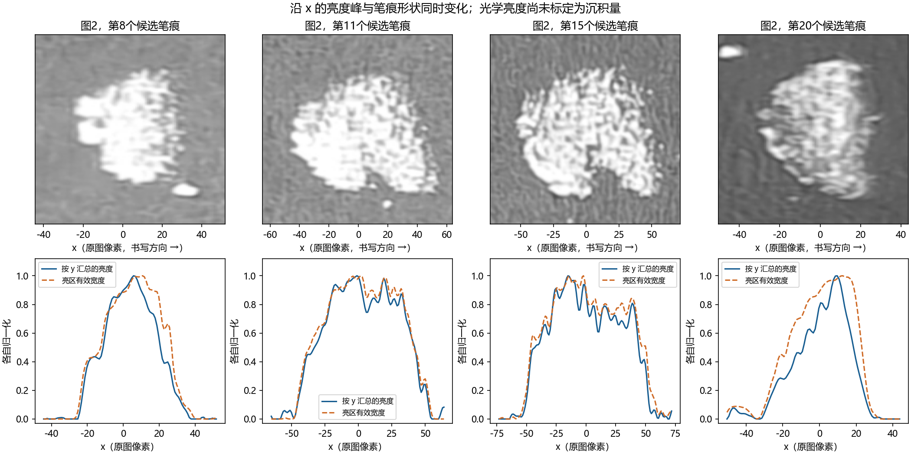

# 笔痕沿书写方向的光学强度剖面

日期：2026-10-29。延续同批实验：29号录音对应图1，30号录音对应图2，书写方向均为从左到右。本补充分析使用两张4096×3072原始JPEG，未新增受控实验或力测量。

## 当前得到的进展

1. 已从原图提取单个笔痕的沿x方向亮度剖面，同时保留二维形状。图2可见单峰、较宽的多峰顶部、偏前峰和偏后峰等不同形态；所选样本不呈现统一的收尾曲线，尚不能确认所有笔痕都具有有限强度截断或缓慢卸载尾。
2. 亮度起伏与亮区覆盖宽度显著同变。图2所选编号8、11、15、20的剖面与有效亮区宽度相关系数约0.93、0.99、0.97、0.91；改变亮区阈值15/25/35后仍有较强同变。两者来自同一张图，存在数学耦合，这不是独立的力学相关性检验，不能据此计算“几何解释了多少压力变化”。它说明观察模型必须同时处理二维足迹与光学浓淡。
3. 图2所选编号8和11的亮区像素中，灰度≥250的比例约36%和31%，灰度≥254.5的比例约14%和12%。这些亮部接近8位图像上限，不能把白色平台直接当成恒定沉积或恒定法向力。编号20的同类比例较低，说明不同位置的光学可用程度也不同。
4. 图1的痕迹沿x较短，部分代表样本的主连通区仅约15–26个原图像素；其边缘形状更容易受到散粉、模糊、压缩与局部背景影响，不宜据此判别微观截断机制。

编号沿用上一轮自动候选几何表，不是独立认证的完整笔痕编号。图2最右端的重叠笔痕不参与本分析。统计单位是同一笔手绘线中的笔痕，不能当作独立实验重复。

## 提取量的含义

原始JPEG按RGB加权得到编码亮度G；不假定相机响应已线性化。对每个x，从中心线两侧的无痕区估计背景B，再计算：

\[
J(x)=\int_{-w}^{w}[G(x,y)-B(x,y)]\,dy.
\]

J是背景扣除后的光学积分量，单位为灰度×像素，不是粉尘质量、法向力或模型中的能量/长度。局部背景扣除也不等于完成照明平场校正。

作图和边缘指标另使用逐笔痕局部修正量：用截取窗口两端的中位数估计基线floor，计算J_plot=max(J−floor,0)，再按峰值归一化。各代表样本CSV同时保留截零前的J和修正后的J_plot；summary.json记录floor。因此曲线零值、尾部宽度和边缘位置亦受局部基线与截零处理影响，不能把图中的零尾直接作为脱离证据。

另外记录：

- 有效亮区宽度W：每列超过背景对比度阈值的像素数量，包含覆盖率、空洞和外轮廓变化，不等于真实接触斑的几何宽度。
- 亮区平均对比度D：阈值内亮像素的平均背景扣除亮度，不能用于证明整块笔痕沉积均匀。
- 主连通区的10%支撑长度、10%–90%上升宽度和90%–10%下降宽度。它们仅描述图像边缘，包含粉笔足迹、散粉、相机模糊和阈值的影响，不等于力学事件持续时间。
- 亮区的近上限像素比例。这里的≥250和≥254.5是图像灰度诊断阈值，不是传感器饱和程度的独立标定。

因此，J与W强相关部分来自定义本身，必须谨慎解释。若亮度按单位面积近似不变，覆盖亮区越多的列，自然会有更大的J。当前照片不能把几何、覆盖率和单位面积沉积浓度的贡献完全分开。

## 对物理模型的约束

### 空间沉积与时间沉积要区分

项目当前后处理 `code/deposit_profile.py` 使用

\[
q(t)=\alpha |F_t(t)v_{rel}(t)|,\qquad
I(x)=\sum_{t:x(t)=x}\frac{q(t)}{|v_{rel}(t)|}.
\]

在单次通过、滑移速度非零、采用该沉积律的条件下，I=α|Ft|；若进一步取滑动库仑摩擦，则I≈αμN。也就是说，在力和沉积系数不变时，不能仅凭速度变慢就声称空间沉积强度按1/v发散。这里的I是模型代理量，不能与JPEG灰度J直接画等号；速度仍可通过摩擦、载荷、磨损和多次经过等间接改变图像。

### 痕端判别

若未来在多曝光、足够分辨率及足迹影响可控的条件下，仍观察到较高强度一直延续到很窄的结束区，才可将“有限强度截断”作为模型约束。它可能对应停止相对滑移而N仍非零，也可能对应很快的脱离过程；必须用同步运动或力信号区分。

当前图像既有较宽下降区也有较陡边缘，而且边缘形状受足迹影响，因此既没有证明真实有限强度截断，也没有证明缓慢法向卸载。

### 亮峰、多峰与回划

同一位置多次经过可在模型中叠加沉积，但月牙形足迹、局部孔隙、散粉和接触位置变化也能形成多峰。双峰不能单独证明回划、二次碰撞或倍周期；照片的从左到右顺序也不保证回划情况下x与时间单调对应。

### 需要增加的观测模型

当前最明确的模型推进，是将单点/一维沉积输出通过有限接触足迹和相机成像过程映射到二维图像，再与实测剖面对照。真实接触足迹不是这张照片的亮区轮廓，仍需独立估计；加入这一层后，才适合用亮度峰、平台、尾部约束N(t)与摩擦律。

## 最小补拍要求

- 对保留下来的同一组笔痕，固定机位和照明，拍正常、较低、再低一档曝光，确保亮部保留纹理。曝光档位应以直方图和像素上限检查为准。
- 选几个孤立笔痕近拍，使其沿x有更多真实采样点；保留同平面尺标及周围空白板面。
- 对比不同曝光下的归一化剖面及结束位置，再决定是否进行E6A的截断判别。单纯软件调暗已有JPEG无法恢复已经丢失的高光信息。

## 复算与核验

运行 `code/analyze_mark_intensity.py --photo1 <原图1> --photo2 <原图2> --out <输出目录>`。需要上一轮 `experiments/E5E6_20261029_audio_marks/photo_*_candidate_geometry.csv`，依赖NumPy、SciPy、Pillow与Matplotlib。

中心线沿用上一轮人工引导，但从4096像素宽原图重新取样；背景来自距中心线45–60个“1824像素缩放坐标”距离的上下侧带，沿y线性插值；积分窗口半宽38个缩放坐标像素。剖面轻度高斯平滑σ=1原图像素。亮区阈值15/25/35用于描述性敏感性检查，未完成独立曝光验收。PNG中的曲线各自归一化，仅比较形状；照片显示范围统一为0–255。

本次核验包括原图裁片与剖面人工对照、阈值敏感性、亮部上限检查及主连通区提取；未把这些检查写成机理验证。原始图片不修改。`summary.json`与CSV保留探索性指标，不能直接用于力反演。

本次只新增本目录与处理脚本，未修改动力学方程或既有实验记录。
