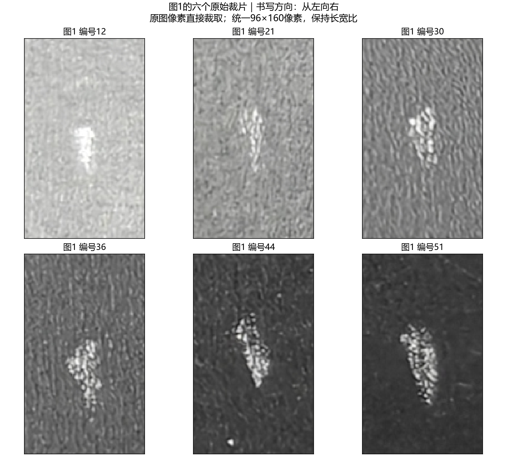
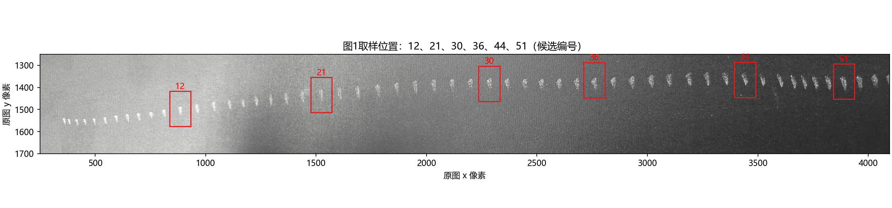
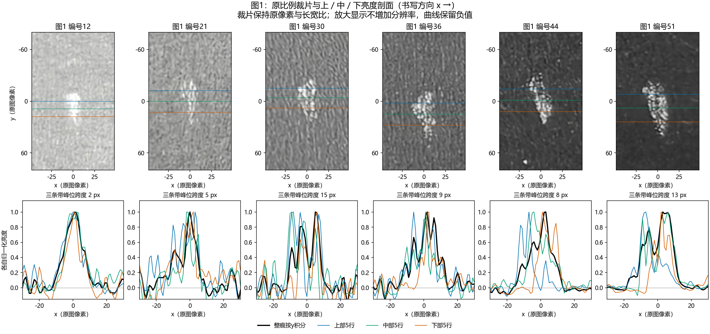

# 图1的六个原比例裁片及窄带剖面对照

日期：2026-10-29。按用户要求，对第一张照片进一步截取分析。选取上一轮候选编号12、21、30、36、44、51，覆盖笔痕序列前、中、后段；编号不是经过独立认证的总事件序号。

原图为 `d2a6526bb6f1086368877baa030f4871.jpg`，4096×3072像素；对应29号录音，书写方向从左向右。每个原始裁片统一96×160像素，保持原始RGB像素、方向和长宽比，未旋转、锐化或自动拉伸对比度。

## 主要结果

| 候选编号 | 原图与剖面观察 | 5行窄带的上/中/下峰位跨度 |
|---|---|---:|
| 12 | 较紧凑，三条窄带的主要亮峰接近；受亮部上限限制 | 2 px |
| 21 | 笔痕很窄，内部亮度不均；局部峰位随高度变化 | 5 px |
| 30 | 亮区有分支，上/中部与下部的主峰位于不同x位置；积分后多峰 | 15 px |
| 36 | 颗粒和局部条纹明显；剖面形状对选带较敏感 | 9 px |
| 44 | 倾斜足迹清楚，上、中、下主峰总体向右移动 | 8 px |
| 51 | 分块、倾斜的亮区造成不同高度的主峰错位 | 13 px |

这里的跨度是同一笔痕不同y位置的**空间峰位差**，不是两次事件的时间间隔，也不是形变幅度或滑移距离。

把窄带厚度改为3、5、9原图像素后，峰位跨度分别为：

- 编号12：2、2、2 px；21：5、5、5 px。
- 编号30：16、15、10 px；36：3、9、8 px。
- 编号44：13、8、9 px；51：11、13、13 px。

因此30、44、51的跨高度峰位错位具有可见的重复性，但精确数值依赖条带平均；36尤其不宜只取一条窄带作物理判决。编号21即使跨度稳定，具体哪个局部峰最大仍会切换。

## 能推进的物理判断

1. **二维几何会影响一维剖面。** 同一笔痕各高度的亮峰不齐，沿y求和时会叠加为宽峰、肩部或多峰。当前数据给出了这种空间错位的直接图像证据，不能把汇总剖面的所有峰谷直接解释成N(t)的峰谷。
2. **多峰不能直接计作多次碰撞。** 编号30与51的亮峰至少部分对应照片中不同位置的亮区。是否存在回划、二次碰撞或多阶段沉积，还需运动学证据。
3. **目前仍不能确认统一的有限强度截断。** 若干窄带的局部下降较陡，但实际变化往往只有几个像素，且不同y处终点有错位。模糊、颗粒与有限足迹都影响边缘宽度。主峰的半高宽指标只是图像描述；多峰情况下只测包含最高峰的半高连通区，不是整个笔痕长度。
4. **编号12不宜作为平台强度的主证据。** 主亮区中约15.8%的灰度≥254.5，接近8位上限。该比例口径是本次主连通亮区，与上一轮大窗口亮像素比例不同，不能当作新曝光实验或传感器饱和标定。

图1最值得进一步研究的是“二维足迹与局部沉积的混合”。编号44可作为几何错位示例；编号30可作为多峰来源示例。当前还不能把每个笔痕简单视为一条已测出的法向力下降曲线。

## 方法与限制

- 从原图直接按整数坐标裁取；每个框的绝对坐标保存在summary.json，单独PNG为未经绘图重采样的裁片。拼图只是放大显示，不能增加原图信息。
- 用裁片顶部和底部各20行估计逐列背景，在y方向线性插值；该处理不是相机响应标定或完整照明校正。
- 在局部背景扣除图上，以25灰度对比度和连通性选取靠近原候选中心的主要足迹。足迹上/下边界仅用于确定采样位置，实际剖面不以亮度阈值逐列裁掉数据。
- 固定在足迹高度25%、50%、75%处取5行窄带；另以3行和9行检查。整痕积分使用包围主足迹的固定y窗口。
- 各剖面减去x两端背景中位数，并以σ=0.6原图像素轻度平滑。保留负值；曲线各自按峰值归一化，不能比较不同曲线的绝对沉积量。
- CSV保留原图x坐标、带符号的积分亮度与归一化窄带剖面；没有用手速把空间宽度换算成卸载时间，也未把峰位差解释为时间差。
- 未旋转或去倾斜后重定义书写方向。全程沿原照片的x轴比较；没有标尺和透视标定，数值单位为原图像素。
- 本次为一条手绘线中六个样本的探索，不代表六次独立重复实验。

复算：`python code/analyze_photo1_crops.py --photo <图1原始JPEG> --out experiments/E5E6_20261029_intensity/photo1_examples`。需要上一轮候选位置CSV，依赖Pillow、NumPy、SciPy、Matplotlib。

本次新增图1裁片、取样位置图、窄带剖面与分析脚本，不修改上一轮结论或模型方程。
