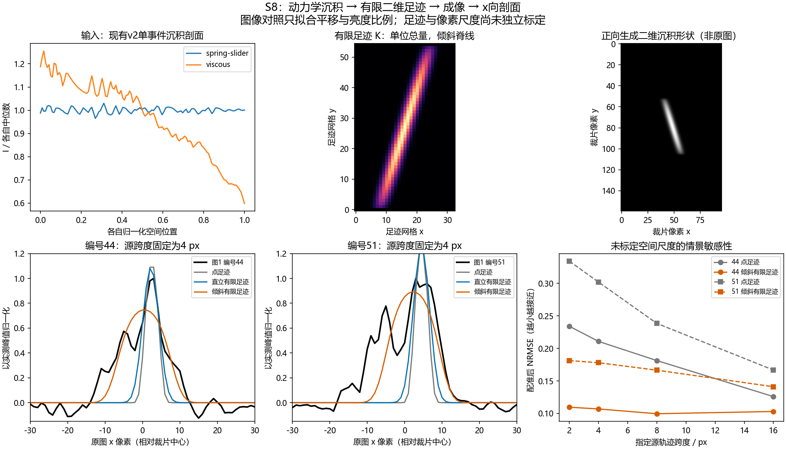
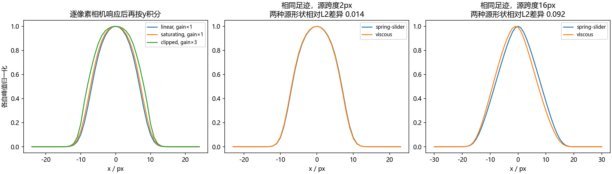

# S8有限足迹观测模型：本地成果归档说明

归档与核查日期：2026-11-02。原始计算日期：现有结果元数据未明确记录，待核实。本说明依据本地已有代码、CSV、图像和`summary.json`整理，不作为原始运行日志，也未将归档日期视为计算日期。

## 1. 目的与实现

将v2的一维沉积代理量经过有限二维足迹、光学模糊和相机响应，映射为二维笔痕及一维光学剖面，用于检查足迹几何对痕端形态的影响。模型比较的是正向观测结果，尚未标定真实像素尺度、足迹和相机响应，不进行接触力反演。

实现见[观测内核](../../code/observation_model.py)、[示例计算](../../code/demo_observation_model.py)与[不变量检查](../../code/tools/check_observation_model.py)。示例依赖已归档的[S4基线强度剖面](../S4_v2正交弹簧基线/S4_基线A_强度剖面.csv)及[图1原比例裁片和分析](../../experiments/E5E6_20261029_intensity/photo1_examples/README.md)。

## 2. 已有情景与结果

- 足迹半高27 px，横向高斯尺度1.5 px，倾斜参数dx/dy=0.31；光学模糊尺度0.7 px。高度和倾斜参考候选44，模糊等参数为情景设定，未独立标定。
- 源跨度取2、4、8、16 px；比较点足迹、有限直立足迹及有限倾斜足迹。沉积源包括弹簧—滑块型与含黏性项LuGre的v2输出。
- 比较时仅调整正亮度增益和横向位置，不据图像反推力史或动力学参数。代码中比较窗口为中心±30 px，位移扫描为−15至15 px、步长0.25 px；`summary.json`的窗口描述不应解读为位移扫描范围。

源跨度4 px、弹簧—滑块型源的归一化均方根误差（NRMSE）如下：

| 足迹 | 候选44 | 候选51 |
|---|---:|---:|
| 点足迹 | 0.210756 | 0.301941 |
| 有限直立足迹 | 0.185740 | 0.265230 |
| 有限倾斜足迹 | 0.106899 | 0.177951 |

有限倾斜足迹改善了这两个示例的剖面匹配，支持后续比较纳入二维几何。候选44参考了自身几何，候选51共享同一足迹设定，两者都不构成独立物理验证。不同源经过同一观测核后也可能相似，拟合改善不足以单独选定摩擦律或证明法向力平台。

## 3. 数据与核验

- [情景及限制](summary.json)、[全部比较指标](comparison_scores.csv)。
- [弹簧—滑块源](source_spring-slider.csv)、[黏性LuGre源](source_viscous.csv)。
- [候选44比较](mark44_comparison.csv)、[候选51比较](mark51_comparison.csv)。

已有情景记录的最大沉积代理总量守恒误差为4.44×10⁻¹⁶；守恒适用于足迹与模糊映射，不要求非线性相机响应后的灰度积分守恒。

2026-11-02归档前运行`python code/tools/check_observation_model.py`，源总量、足迹/模糊总量、线性叠加、点足迹极限、几何展宽及相机处理次序检查全部通过。本次未重跑完整S8示例生成图表，保留原有结果文件字节。

复算示例：在仓库根目录运行`python code/demo_observation_model.py --out <新输出目录>`，依赖NumPy、SciPy、Matplotlib、Pillow及上述S4和裁片数据。后续应以独立尺度、足迹和相机标定替换情景设定，并按整次书写划分标定/留出数据。
