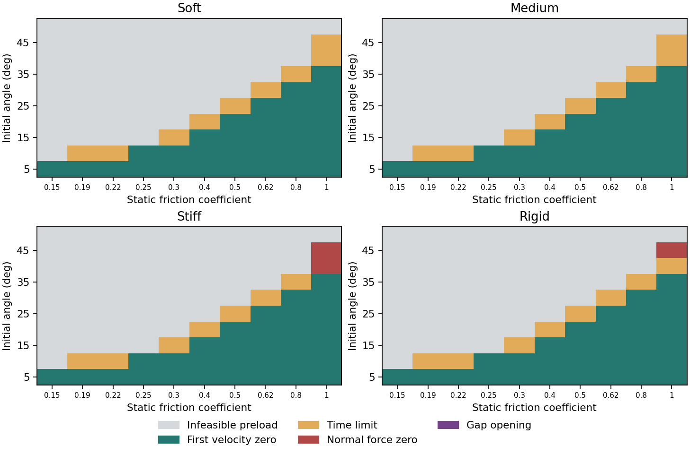
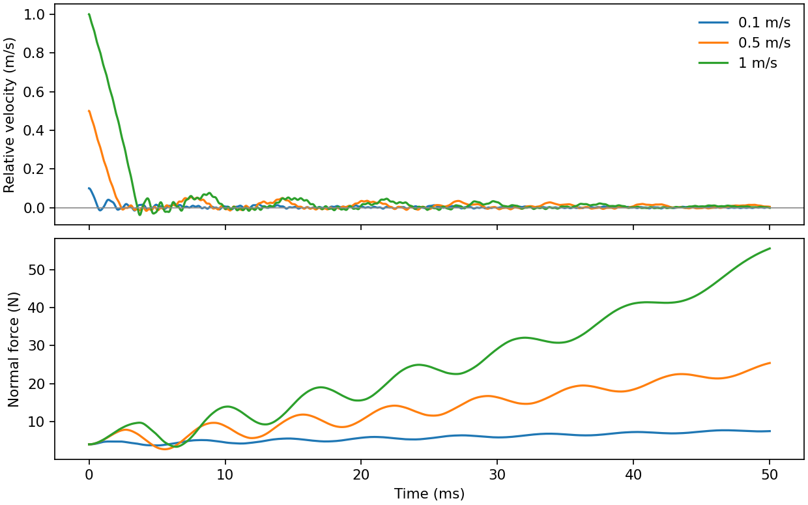
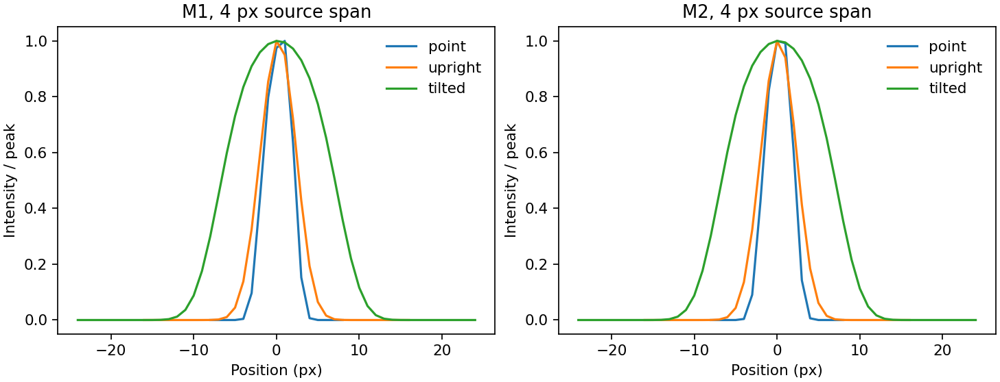

# v3 数值全量复算 · 2026-11-17

名义工况从静态预载出发，板速阶跃至 0.5 m/s。尖端相对板面的速度在 **2.364 ms** 首次从正侧到零，首次滑移跨度为 **0.553 mm**，此时法向力为 **7.652 N**。同一参数下，刚性接触基准的对应值为 **1.976 ms、0.533 mm、7.129 N**。首停后继续积分至 50 ms 时，三档板速都出现了速度反向，法向力全程为正。 [单痕轨迹与独立 DOP853 复核](../V3_单痕基准_2026-11-17/结果说明.md) · [逐工况结果](cases.csv)

批量表包含 **1,074 条算例记录**，其中 **682 条完成积分**，**392 条不满足静态预载**。完成积分的记录中，520 条终止于首次速度过零，43 条终止于法向力归零，119 条达到时间上限。S8 另有 72 个正向观测情景和 48 次照片对照。

## 模型与事件

粉笔按均匀刚杆处理，状态为质心两个平动坐标、一个转角和 LuGre 内态。两根正交弹簧作用于同一连接点 H，接触力作用于尖端 T。以名义长度 80 mm 为基准，H、T 至质心的力臂分别为 40 mm，方向相反。基准沿用名义结构刚度 300 和 10⁶ N/m、初始倾角 20°、法向预载 4 N、法向罚刚度 2×10⁴ N/m 和接触阻尼 1 N·s/m。参数为装置标定前的情景设定。

静止时以 H 为矩心求接触切向力，并以合力为零确定两向弹簧预载。若所需切向力超出静摩擦容量，表中记为 `infeasible_preload`，其动力学列留空。20°、4 N 的基准需要约 1.443 N 切向力，对应的静摩擦系数下限约 **0.361**。角度—摩擦图中的灰色区域因此受初态可达性约束。

罚接触使用单边 Kelvin–Voigt 型法向力。刚性对照在贴板段令尖端法向加速度为零，并求约束反力，适用于干摩擦 LuGre。按相对速度向下过零、试算法向力向下过零、几何间隙开启和时间上限记录终点。力归零可以发生在几何间隙开启之前。S9 允许越过速度零点，仍在首次失去接触时停止；50 ms 内的多次速度过零描述接触内运动，完整的离面、撞击、再接触与可见虚线周期仍待验证。

## 原研究工况如何复算

| 研究 | v3 计算口径 |
|---|---|
| S0、S4 | 名义单痕和两项结构/板速对照。S4 B 使用原两向刚度，转矩由 H 的偏心距给出 |
| S1 | 原法向刚度网格，分别固定预载和初始压入。旧非零初始角速度作为静态预载后的角速度扰动，质心初速度为零 |
| S2、S3、S7 | 原正则化速度和本构参数用于 v3。tanh 比较在板速阶跃后切换为无内态的滑动律，初始机械预载取与 LuGre 相同的力矩平衡值 |
| S4v1 | 原 245 点摩擦—几何—刚度网格。以 `θ = arccos(h/L)` 映射初始倾角，旧摩擦系数作为动摩擦系数，静/动比取 v3 基准值 |
| S5、S5b | 步长、容差、法向刚度/阻尼、竖向结构刚度、鬃毛刚度及刚性约束对照 |
| S6、S6b | 两向刚度、H 偏心距、板速、角度及摩擦扫描。保留 10×10×4 主网格及静/动比、阻尼和板速切片，板速切片补测满足静预载的摩擦区间。旧独立转动刚度由 H 偏心距扫描承接 |
| S8 | 以 v3 的 M1/M2 单痕作为输入，复算点足迹、直立与倾斜有限足迹和三种响应情景；按原配准规程与 44、51 号笔痕剖面对照 |
| E1、E2 | 复算 56 个首次滑移工况。E2 重算三种稳态扫速设计、每个四档情景 1,000 组合成拟合，并将 E1 阈值区间与稳态参数的局部不确定度传播到 v3 首次滑移跨度 |
| S9 | 三档板速下保留首停后的连续接触轨迹，不重置 LuGre 内态 |





## 沉积、成像与数值核验

M1 对 $N|v_{\rm rel}|$ 作时间积分，单位为 N·m。M2 逐时间区间以切向输入功减去 LuGre 鬃毛储能变化，单位为 J。干摩擦 LuGre 中该量对应不可逆耗散。含鬃毛阻尼的情景使用带符号的功减储能余量，并记录负部；空间积分保留该符号。空间映射按板面坐标累计，非单调轨迹按位置汇总往返贡献。首停位置、沉积代理和实际光学边缘对应不同观测量。

S8 的四档像素跨度、足迹形状、模糊尺度、相机响应和增益是情景输入。实测对照只在原窗口内拟合横向平移及正增益，44 号本身参与过足迹几何设定。照片对照未提供像素跨度或沉积系数的独立标定。 [足迹数据](footprints.csv) · [照片比较](photo_comparison.csv)

当源跨度设为 4 px、足迹倾斜时，44 号的归一化均方根误差为 M1 0.1070、M2 0.1071，51 号分别为 0.1780、0.1782。该情景的照片剖面难以区分两种沉积代理。



E1 阈值中点为 0.68626。板速 10 mm/s 时，用该中点得到首次滑移跨度 2.511 μm，用名义静摩擦系数 0.62 得到 2.640 μm。E2 四档扫速情景在名义 Stribeck 特征速度 10 mm/s 时，传播至该跨度的局部标准误为 0.018 μm。 [逐工况结果](cases.csv) · [不确定度结果](e2_span_uncertainty.csv)

名义工况用 DOP853 和 LSODA 交叉复算。复算程序核对静态平衡、标量与批量载荷、板面位移积分、刚性约束位置、空间分箱守恒及足迹和模糊前后的总量。批量表中几何位置与相对速度时间积分最大差为 4.83×10⁻¹⁰ m，空间分箱相对守恒误差小于 1.70×10⁻¹⁴。直接积分功率减储能导数与逐区间功减储能差的最大相对差约 0.094%，出现在高刚度卸载工况。 [统计及核验误差](summary.json)

## 复算与数据

在仓库根目录执行，依赖 NumPy、SciPy、Matplotlib、Pillow。

```powershell
python -B code/v3_single_mark.py
python -B code/v3_recalculate.py
```

- [全工况参数、终点和积分](cases.csv) · [S4/S7/E1 空间曲线](profiles.csv) · [首停后轨迹](post_stop.csv)
- [E2 扫速设计](e2_designs.csv) · [合成拟合](e2_synthetic_recovery.csv) · [稳态沉积比](e2_steady_ratios.csv) · [跨度不确定度](e2_span_uncertainty.csv)
- [v3 力学源码](../../code/v3_single_mark.py) · [批量复算](../../code/v3_recalculate.py) · [扫速辨识](../../code/v3_speed_design.py)
