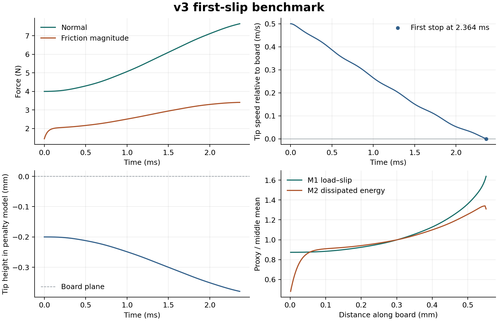

# v3 单痕基准 · 2026-11-17

初态倾角为 20°，法向预载为 4 N。板面从静止阶跃至 0.5 m/s 后，尖端相对板面的速度在 **2.364 ms** 首次从正侧到零，累计滑过 **0.553 mm**。法向力在积分区间内从 4.000 N 升至 **7.652 N**，接触压入量从 0.200 mm 增至 0.380 mm。首停前未触发法向力归零或几何开缝。



## 工况与初态

v3 力学采用质心的两个平动坐标和一个转角。两根正交弹簧共用连接点 H，基准将 H 和尖端 T 设在均匀刚杆的两端。弹簧力与接触力分别按 H、T 至质心的力臂形成转矩。法向接触采用单边 Kelvin–Voigt 罚接触，切向采用干摩擦 LuGre（σ₁＝σ₂＝0）。板面沿负 x 方向运动，倾角从向下法线量起。

| 输入 | 基准取值 |
|---|---|
| 名义长度、半径、密度 | 80 mm、3.5 mm、2300 kg/m³，得质量 7.081 g、质心惯量 3.777×10⁻⁶ kg·m² |
| 两向弹簧刚度 | kₓ＝300 N/m，kᵧ＝10⁶ N/m，两向结构阻尼取零 |
| 法向接触 | kₙ＝2×10⁴ N/m，cₙ＝1 N·s/m |
| LuGre | μₛ＝0.62，μₖ＝0.51，vₛ＝0.01 m/s，σ₀＝10⁵ N/m |

几何量级、刚度和摩擦参数借用旧基准的名义设定。H 的位置、均匀刚杆和板速阶跃均为本次计算假设，装置参数仍待标定。板静止时，绕 H 的力矩平衡给出初始切向接触力 −1.443 N，幅值低于静摩擦上限 2.480 N。初始弹簧力为 (+1.443, −3.931) N，LuGre 内态据该切向力初始化。初态合力残差约 2.4×10⁻¹⁴ N，合力矩残差约 3.3×10⁻¹⁶ N·m。板速阶跃时延续该状态。

## 数值核验

| DOP853 最大步长（μs） | 首停（ms） | 首次滑移跨度（mm） | 首停法向力（N） |
|---:|---:|---:|---:|
| 20 | 2.363553 | 0.552922 | 7.651790 |
| 10 | 2.363553 | 0.552922 | 7.651790 |
| 5 | 2.363553 | 0.552922 | 7.651790 |

相对滑速向下过零、试算法向力向下过零、尖端压入量向下过零分别设为终止事件。三档步长的首停时间、滑移跨度、首停法向力及 M2 耗散积分相对差均小于 10⁻⁸。时间积分的相对滑速与几何位置换算的板面坐标最大差约 8.5×10⁻¹² m。

两条空间曲线分别使用 M1 的载荷—滑移代理 $N|v_{\rm rel}|$ 和 M2 的干摩擦 LuGre 不可逆耗散代理 $F_r^2|v_{\rm rel}|/G$。以 $q\,dt$ 累积后分到 200 个等宽空间箱。空间积分与时间积分的相对差约 4.4×10⁻¹⁵。M2 总耗散 1.257 mJ，接触功率积分扣除内态储能变化后，能量闭合的相对误差约 6.7×10⁻⁸。

本算例在首停处截断。0.553 mm 表示首次滑移跨度，后续再滑、离面及可见痕长仍需继续计算和验证。两条曲线是未标定的沉积代理，照片亮度需要足迹与成像模型。

## 复算

在 `ipyt-chalktrick` 目录执行，依赖 NumPy、SciPy 和 Matplotlib。

```powershell
python -B code/v3_single_mark.py
```

[源码](../../code/v3_single_mark.py) · [完整参数及收敛结果](summary.json) · [轨迹](trajectory.csv) · [空间分箱](profile.csv)
